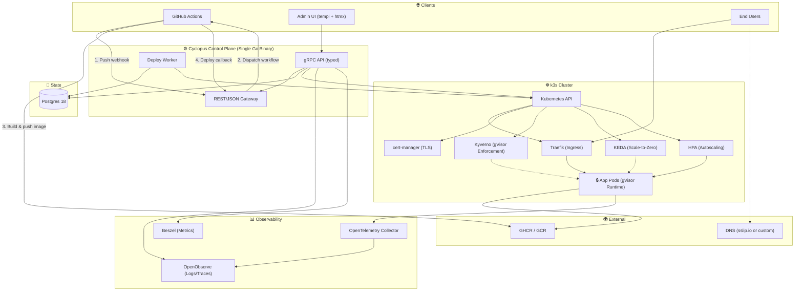

# Cyclopus

🚀 **Self-hosted PaaS for small teams.** Go from an empty VPS to git-push deploys with automatic HTTPS, running on a customer-owned k3s cluster.

## What it is

Cyclopus orchestrates GitHub Actions to build your images, then deploys them to Kubernetes with automatic preview environments, rollback, and per-app workload isolation. Designed for teams that want full control over their infrastructure without hand-writing Kubernetes manifests.

## Architecture



**Core components:**
- 🏗️ **Single Go binary** serving gRPC (internal) and REST/JSON (external) from one `.proto` definition
- 🎨 **templ + htmx + Tailwind UI** in the same process
- 💾 **Postgres 18** as authoritative source of truth with native `uuidv7()` support
- ☸️ **k3s cluster** with Traefik ingress, cert-manager for HTTP-01 TLS, Kyverno for gVisor policy enforcement
- 🔒 **Hard security isolation:** gVisor per-pod kernel sandboxing + NetworkPolicy default-deny, both fail-closed
- 🚀 **Deploy model:** Orchestrates GitHub Actions to build, validates digest-only image refs server-side
- 🔄 **Worker** handles async deploys, lease recovery, and webhook delivery with all state in Postgres (survives restarts)

## Features

### 🚀 Core Capabilities
- ✅ Full gRPC/REST API surface (15 service interfaces)
- ✅ Canonical OpenAPI 3 document at `/openapi.json` + browsable Scalar API reference at `/docs` (generated from the proto, publicly served)
- ✅ Complete store layer (34 files) and service layer (24 files) with integration tests
- ✅ Deploy worker with async loop, lease management, orphan recovery
- ✅ Kubernetes orchestration with automatic rollout management
- ✅ Auth: bcrypt + pepper, scoped tokens, rate limiting
- ✅ UI handlers for all admin surfaces (Projects, Apps, Environments, Releases, Logs, Domains, Rollback, Webhooks, Audit)
- ✅ Helm chart with Deployment, RBAC, Kyverno policies, multi-arch support
- ✅ OpenObserve + Beszel observability wiring
- ✅ Webhook delivery: at-least-once, retry with backoff, auto-disable after failures

### 🧪 Test Coverage
- ✅ E2E flow tests over bufconn gRPC
- ✅ Integration tests across store, service, adapter, auth layers
- ✅ Shell tests for Helm chart policies, schema validation, workflow gates

## 🔒 Security

- 🛡️ **gVisor isolation:** `runtimeClassName` injected and enforced by two independent Kyverno policies (mutating + validating), both fail-closed
- 🔐 **NetworkPolicy:** Default-deny ingress + egress per app namespace, fail-safe namespace creation order
- 🔏 **Image digest enforcement:** Server-side validation, tags rejected
- 🎫 **Scoped API tokens:** `deploy:app_id` validated against app config
- ✍️ **Webhook signatures:** HMAC-SHA256 with replay protection
- 🗝️ **Secrets management:** Never written to Postgres, all stored as Kubernetes Secret refs
- 👤 **Distroless container:** Static nonroot image (UID 65532)
- ⏱️ **Timeout enforcement:** Kubernetes `progressDeadlineSeconds` (survives control-plane restarts)

## 🎯 Key Design Decisions

**🔧 Go:** Reference Kubernetes ecosystem (`client-go`). Single binary with no external dependencies.

**📡 gRPC + grpc-gateway:** One `.proto` definition, typed gRPC internally, REST/JSON for external callers from the same schema.

**📖 API reference:** The same proto generates the public docs — `buf generate` (adds `protoc-gen-openapiv2` → Swagger 2.0) then `go run ./cmd/gen-openapi gen/openapi/cyclopus/v1/cyclopus.swagger.json internal/apidocs/openapi.json` converts to the canonical OpenAPI 3 document, embedded and served publicly at `/openapi.json` with a Scalar reference UI at `/docs`. When the proto changes, docs regenerate — they can never drift.

**💾 Postgres 18:** Native `uuidv7()` for time-sortable IDs, atomic `RETURNING WITH (OLD AS...)` for queued commit coalescing (prevents silent commit drops under concurrent pushes).

**🎯 Imperative API:** Directly creates/patches Kubernetes objects. Consequence: doesn't self-heal from manual drift. Upside: Postgres is the source of truth, every Kubernetes object is regenerable from it — clean DR story.

**🔄 One mutable Deployment per environment:** Rollback is fast because it skips the build, not because it skips the rollout. It costs one rolling update (seconds to a minute), not sub-second alias flip.

**📊 HPA by default, KEDA opt-in:** HPA can't scale to zero; KEDA core handles cron-triggered scale-to-zero natively. KEDA HTTP Add-on (beta) handles HTTP-triggered scale-to-zero. Mutually exclusive because a KEDA `ScaledObject` creates its own HPA — two controllers managing the same Deployment fight. Apps opt in via `scaling_mode`; default `hpa` mode never touches KEDA.

## ✨ Distinctive Features

- 📝 Formal, auditable deploy saga with durable state and crash-safe lease recovery
- 🔒 Hard security isolation by default (gVisor + NetworkPolicy fail-closed), not opt-in
- 🔏 Image digest enforcement server-side (tags rejected)
- ⚡ Postgres18-specific atomic `RETURNING WITH (OLD AS...)` for queued commit coalescing
- 🎫 Idempotency keys on all mutating operations

## 🛠️ Tech Stack

| Layer | Choice |
|---|---|
| ☸️ Orchestrator | k3s (Traefik disabled, secrets encryption enabled, single-stack IPv4) |
| 🔧 Language | Go |
| 📡 API | gRPC (grpc-go) + grpc-gateway (REST/JSON) |
| 🌐 HTTP router | chi |
| 🎨 UI | templ + htmx + Tailwind |
| 💾 Database | Postgres 18 |
| 🔄 Migrations | golang-migrate, embedded via `embed.FS`, applied at boot |
| 🚦 Ingress | Traefik (managed install) |
| 🔐 TLS | cert-manager (HTTP-01, no wildcards) |
| 🛡️ Compute isolation | gVisor RuntimeClass + Kyverno (mutating + validating, fail-closed) |
| 🔒 Network isolation | NetworkPolicy via kube-router (default) or Calico (optional) |
| 📊 Autoscaling | HPA (default, production), KEDA core + HTTP Add-on (opt-in, beta) |
| 📈 Telemetry | OpenTelemetry Collector (DaemonSet) → OpenObserve |
| 📉 Metrics | Beszel |
| 💾 Postgres backup | WAL-G (RPO 60s) |
| 📦 Registries | GHCR, GCR |

## 📁 Repository Structure

```
.
├── cmd/                      # Main entrypoint (+ gen-openapi: swagger→OpenAPI 3 converter)
├── internal/
│   ├── apidocs/             # Embedded OpenAPI 3 spec + /openapi.json & /docs handlers
│   ├── server/              # gRPC handlers (1988 lines)
│   ├── service/             # Business logic layer (24 files)
│   ├── store/               # Postgres data layer (34 files)
│   ├── worker/              # Async deploy worker
│   ├── adapters/
│   │   ├── github/          # GitHub App dispatch, correlation
│   │   ├── kubernetes/      # Deploy, lifecycle, recovery
│   │   └── observability/   # OpenObserve, Beszel clients
│   ├── auth/                # bcrypt, tokens, rate limiting
│   └── uihandler/           # templ + htmx handlers
├── charts/cyclopus/         # Helm chart
├── scripts/
│   ├── install.sh           # Bootstrap script
│   └── integration.sh       # Test harness
├── tests/
│   ├── chart/               # Kyverno policy tests
│   ├── schema/              # Schema contract tests
│   └── workflow/            # Deploy workflow fixtures
└── docs/
    └── decisions/           # Phase 0 binding contracts
```

## 🚀 Getting Started

**Prerequisites:**
- 64-bit Linux VPS (app-workload nodes require nested virtualization for gVisor)
- SSH access
- Nested virtualization enabled (`/dev/kvm` present)

**One-line install (similar to Coolify):**
```bash
curl -fsSL https://get.cyclopus.dev | bash
```

**Manual install:**
```bash
# Bootstrap k3s + gVisor + platform dependencies
./scripts/install.sh

# Install Cyclopus via Helm
helm install cyclopus ./charts/cyclopus \
  --set config.kubernetes.previewHostnameSuffix="<ingress-ip-dashed>.sslip.io"

# First user creation auto-creates the organization
# Visit the UI and create your account
```

**TLS Certificates:**
- Production Let's Encrypt certificates are issued automatically by default
- Each unique hostname (e.g., `203-0-113-7.sslip.io`) has its own Let's Encrypt rate limit (50 certs/week)
- For development/testing, you can switch to staging certificates with `--set config.kubernetes.certManagerClusterIssuer="letsencrypt-staging"`

## 💻 Development

**Run tests:**
```bash
# Unit + integration tests (requires Postgres)
go test ./...

# Integration tests only
./scripts/integration.sh

# E2E flow tests
go test -v ./internal/server -run TestE2EUserFlows
```

**Run locally:**
```bash
# Requires: Postgres 18, k3s cluster
go run cmd/cyclopus/main.go serve
```

## 🤝 Contributing

Cyclopus is under active development. Contributions welcome!

**Areas of focus:**
1. 🔧 Wire CI workflow (GitHub Actions: `go test ./...` + integration tests on PR/commit)
2. 📝 Validate and document the install path
3. 🧪 Add test coverage for UI handler layer

## 📄 License

[License TBD]

## 📊 Platform Comparison

| Feature | Cyclopus | Vercel | Netlify | Coolify | Dokploy |
|---------|----------|--------|---------|---------|---------|
| 🏠 **Hosting** | Self-hosted | Cloud | Cloud | Self-hosted | Self-hosted |
| 🛡️ **Isolation** | gVisor + NetworkPolicy (fail-closed) | Multi-tenant cloud | Multi-tenant cloud | Container-level | Container-level |
| 🔐 **Security Model** | Kernel-level sandbox by default | Shared infrastructure | Shared infrastructure | Process isolation | Process isolation |
| 🚀 **Deploy Model** | Orchestrates GitHub Actions | Integrated build | Integrated build | In-cluster builds | In-cluster builds |
| 🔄 **Rollback** | One rolling update (~30s) | Instant alias switch | Instant alias switch | Similar to Cyclopus | Similar to Cyclopus |
| 👥 **Multi-team** | Single org | Full multi-tenant | Full multi-tenant | Multi-tenant | Multi-tenant |
| 🔗 **Git Providers** | GitHub | GitHub, GitLab, Bitbucket | GitHub, GitLab, Bitbucket | GitHub, GitLab, Gitea | GitHub, GitLab, Gitea |
| 💾 **State Recovery** | Crash-safe lease recovery | N/A (managed) | N/A (managed) | N/A | N/A |
| 🏗️ **Architecture** | Imperative API, Postgres source of truth | Proprietary | Proprietary | Docker Compose | Docker Compose |
| ⚙️ **Control Plane** | Single Go binary | Managed service | Managed service | Multiple services | Multiple services |
| 📏 **Target Scale** | 10-15 apps, designed to scale | Unlimited (managed) | Unlimited (managed) | Small to medium | Small to medium |
| 💰 **Cost Model** | Self-hosted (infrastructure only) | Pay per usage | Pay per usage | Self-hosted (infrastructure only) | Self-hosted (infrastructure only) |
| 🌐 **Edge Network** | No (single region) | Global edge | Global edge | No (single region) | No (single region) |
| 🔍 **Observability** | OpenObserve + Beszel | Built-in analytics | Built-in analytics | Basic monitoring | Basic monitoring |
| 🎯 **Preview Envs** | ✅ Automatic per branch | ✅ Automatic per branch | ✅ Automatic per branch | ⚠️ Manual | ⚠️ Manual |
| 📦 **Image Registry** | GHCR, GCR | Built-in | Built-in | Any | Any |
| 🔐 **Secrets** | Kubernetes Secrets (encrypted at rest) | Environment variables | Environment variables | Environment variables | Environment variables |

### 🎯 Use Cyclopus when you need:
- ✅ Full infrastructure control (own VPS, own data)
- ✅ Kernel-level workload isolation (gVisor)
- ✅ Hard security boundaries between apps
- ✅ Predictable costs (no per-usage billing)
- ✅ Kubernetes orchestration without writing manifests
