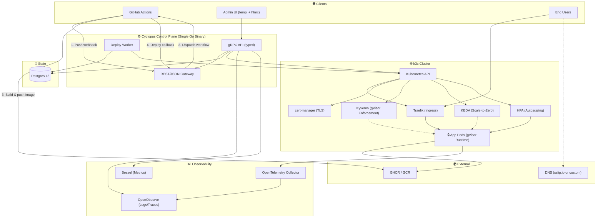

# Cyclopus

🚀 **Self-hosted PaaS for small teams.** Go from an empty VPS to git-push deploys with automatic HTTPS, running on a customer-owned k3s cluster.

## What it is

Cyclopus orchestrates GitHub Actions to build your images, then deploys them to Kubernetes with automatic preview environments, rollback, and per-app workload isolation. Designed for teams that want full control over their infrastructure without hand-writing Kubernetes manifests.

## Architecture



**Core components:**
- 🏗️ **Single Go binary** serving gRPC (internal) and REST/JSON (external) from one `.proto` definition
- 🎨 **templ + htmx + Tailwind UI** in the same process
- 💾 **Postgres 18** as authoritative source of truth with native `uuidv7()` support
- ☸️ **k3s cluster** with Traefik ingress, cert-manager for HTTP-01 TLS, Kyverno for gVisor policy enforcement
- 🔒 **Hard security isolation:** gVisor per-pod kernel sandboxing + NetworkPolicy default-deny, both fail-closed
- 🚀 **Deploy model:** Orchestrates GitHub Actions to build, validates digest-only image refs server-side
- 🔄 **Worker** handles async deploys, lease recovery, and webhook delivery with all state in Postgres (survives restarts)

## GitHub webhook operations

The complete tracked operator guides are:

- [GitHub App setup](docs/github-app.md) — singleton manifest flow, exact permissions/subscriptions, HMAC rotation, and compatible workflow contract.
- [GitHub webhook operations](docs/operations.md) — keyring, all runtime defaults, rollout/rollback, signed verification, SQL, metrics, alerts, and troubleshooting.

Configure each Cyclopus GitHub App to send webhooks to
`https://<cyclopus-host>/webhooks/github`. Subscribe only to **Push**,
**Installation**, and **Installation repositories**. Cyclopus handles
`installation` actions `created`, `unsuspend`, `new_permissions_accepted`,
`suspend`, and `deleted`, plus `installation_repositories` actions `added` and
`removed`. Pull-request events are not required. An authenticated `ping` returns
HTTP `202` without creating an inbox row or requiring tenant state.

The endpoint verifies `X-GitHub-Signature-256` before durably storing an
AES-GCM-encrypted payload. A successful non-ping request returns `202` only
after that transaction commits. Replays also return `202`; a delivery-ID/content
mismatch returns `409`. Do not log request bodies, signatures, secret values,
encrypted payload columns, or decrypted payloads.

### Secrets and key rotation

HMAC signing secrets use Kubernetes references, not inline values. The active
settings are `CYCLOPUS_WEBHOOK_GITHUB_ACTIVE_SECRET_REF` and
`CYCLOPUS_WEBHOOK_GITHUB_ACTIVE_KEY_VERSION`. During rotation, also set
`CYCLOPUS_WEBHOOK_GITHUB_PREVIOUS_SECRET_REF`,
`CYCLOPUS_WEBHOOK_GITHUB_PREVIOUS_KEY_VERSION`, and the RFC3339 cutoff
`CYCLOPUS_WEBHOOK_GITHUB_SECRET_OVERLAP_UNTIL`. Cyclopus accepts the previous
secret only before that cutoff. Remove the previous settings after GitHub uses
the active secret. Secret references must use the control-plane namespace; any
additional `cyclopus-webhook-*` Secret must be immutable, Helm-owned by the
release, labeled `cyclopus.app/credential-purpose=webhook-signing`, and listed
in `CYCLOPUS_WEBHOOK_ALLOWED_SECRET_REFS` so RBAC can grant exact-name access.

Payload encryption is separate from webhook HMAC signing. Set
`CYCLOPUS_WEBHOOK_PAYLOAD_ENCRYPTION_KEY_FILE` to a mounted JSON file with this
shape:

```text
{
  "active_version": <version string>,
  "keys": {
    <active version>: <standard-base64 AES key>,
    <retained version>: <standard-base64 AES key>
  }
}
```

Each encoded key must decode to 16, 24, or 32 bytes. The active version must
exist in `keys`; retain old versions until every payload encrypted with them has
been terminal and redacted. The file must not permit group or world access
(`0600` is recommended). Mount it read-only from an existing Secret or external
secret provider; never put key bytes in Helm values or environment variables.

Example non-secret environment wiring:

```yaml
env:
  - name: CYCLOPUS_WEBHOOK_PAYLOAD_ENCRYPTION_KEY_FILE
    value: /var/run/secrets/cyclopus-webhook-payload/keyring.json
  - name: CYCLOPUS_WEBHOOK_GITHUB_ACTIVE_SECRET_REF
    value: k8s-secret://cyclopus/cyclopus-github-app#webhook-secret
  - name: CYCLOPUS_WEBHOOK_GITHUB_ACTIVE_KEY_VERSION
    value: managed
  - name: CYCLOPUS_WEBHOOK_ALLOWED_SECRET_REFS
    value: k8s-secret://cyclopus/cyclopus-webhook-previous#webhook-secret
volumeMounts:
  - name: github-webhook-payload-keyring
    mountPath: /var/run/secrets/cyclopus-webhook-payload
    readOnly: true
volumes:
  - name: github-webhook-payload-keyring
    secret:
      secretName: cyclopus-webhook-payload-keyring
      defaultMode: 0600
```

The stock chart does not own or generate payload-encryption keys. Supply the
mount and environment settings through your deployment customization. The
example uses only references and paths; it contains no key material.

### Ingress and worker limits

Defaults and matching environment names are:

| Area | Environment variable | Default |
|---|---|---:|
| Webhook body | `CYCLOPUS_WEBHOOK_GITHUB_BODY_LIMIT` | 1 MiB (`1048576`) |
| Webhook handlers | `CYCLOPUS_WEBHOOK_GITHUB_MAX_CONCURRENT` | 4 |
| Webhook body-read deadline | `CYCLOPUS_WEBHOOK_GITHUB_BODY_READ_TIMEOUT` | 10s |
| Per-IP rate / burst | `CYCLOPUS_WEBHOOK_GITHUB_RATE_LIMIT_PER_MINUTE`, `CYCLOPUS_WEBHOOK_GITHUB_RATE_LIMIT_BURST` | 120/min, 30 |
| HTTP header deadline | `CYCLOPUS_HTTP_READ_HEADER_TIMEOUT` | 5s |
| HTTP request deadline | `CYCLOPUS_HTTP_READ_TIMEOUT` | 15s |
| HTTP response deadline | `CYCLOPUS_HTTP_WRITE_TIMEOUT` | 30s |
| HTTP header limit | `CYCLOPUS_HTTP_MAX_HEADER_BYTES` | 1 MiB (`1048576`) |
| Worker scan | `CYCLOPUS_GITHUB_EVENT_WORKER_SCAN_INTERVAL` | 1s |
| Delivery concurrency | `CYCLOPUS_GITHUB_EVENT_WORKER_DELIVERY_CONCURRENCY` | 4 |
| Fan-out concurrency | `CYCLOPUS_GITHUB_EVENT_WORKER_FANOUT_CONCURRENCY` | 2 |
| Routing-intent concurrency | `CYCLOPUS_GITHUB_EVENT_WORKER_INTENT_CONCURRENCY` | 8 |
| Lease / processing timeout | `CYCLOPUS_GITHUB_EVENT_WORKER_LEASE_DURATION` / `CYCLOPUS_GITHUB_EVENT_WORKER_PROCESSING_TIMEOUT` | 60s / 20s |
| Attempts / retry | `CYCLOPUS_GITHUB_EVENT_WORKER_MAX_ATTEMPTS`, `CYCLOPUS_GITHUB_EVENT_WORKER_INITIAL_RETRY`, `CYCLOPUS_GITHUB_EVENT_WORKER_MAX_RETRY` | 12, 5s, 15m |
| Payload retention / cleanup | `CYCLOPUS_GITHUB_EVENT_WORKER_PAYLOAD_RETENTION`, `CYCLOPUS_GITHUB_EVENT_WORKER_CLEANUP_INTERVAL`, `CYCLOPUS_GITHUB_EVENT_WORKER_CLEANUP_BATCH` | 24h, 1m, 100 |
| Shutdown | `CYCLOPUS_GITHUB_EVENT_WORKER_SHUTDOWN_GRACE` | 30s |
| Fan-out maximum / batch | `CYCLOPUS_GITHUB_EVENT_WORKER_MAX_FANOUT`, `CYCLOPUS_GITHUB_EVENT_WORKER_FANOUT_BATCH` | 10000, 100 |
| Legacy intent compatibility limit | `CYCLOPUS_GITHUB_EVENT_WORKER_MAX_INTENTS` | 1000 |
| Metrics listener / public opt-in | `CYCLOPUS_METRICS_ADDRESS`, `CYCLOPUS_METRICS_ALLOW_PUBLIC` | `127.0.0.1:9090`, `false` |

At the edge, enforce a body limit no larger than the application limit, reject
slow headers within 5s, preserve the three `X-GitHub-*` authentication headers,
and use a route-specific rate/concurrency limit that sheds excess requests with
`429`. Give the upstream enough time to exceed the 10s body-read deadline, but
keep it below the 30s application write timeout. Disable request decompression:
Cyclopus rejects webhook requests with `Content-Encoding`.

The worker leases durable deliveries and intents, renews leases while
processing, retries transient database/GitHub failures with bounded exponential
backoff, and terminally fails exhausted work at attempt 12. Terminal payloads
remain encrypted for the retention window and are then redacted in bounded
cleanup batches. Startup performs cleanup and an initial claim scan before
`/readyz` becomes ready. Shutdown clears readiness, stops processing, waits up
to the shutdown grace, stops terminal writes, and leaves unfinished leases for
recovery by the next process.

### Rollout, rollback, and routing semantics

Migrations are embedded and run at boot. Deploy the Phase 5 binary so it applies
`000010_github_webhook_routing`, `000011_github_unverified_revocation`,
`000012_github_webhook_signature_key_version`,
`000013_github_webhook_conflict_error`, and `000014_github_routing_fanout` in
order. Never run the new binary against a partially applied sequence. Before
enabling GitHub delivery:

1. Back up Postgres, deploy the binary, and wait for migrations and `/readyz`.
2. Confirm the pod can read the HMAC Secret references and the `0600` payload
   keyring file without printing either value.
3. Set the GitHub App webhook URL and event subscriptions listed above.
4. Send a GitHub `ping` and confirm HTTP `202`.
5. Push a production branch and a preview branch, then monitor delivery/intent
   status, worker retries, fanout, and environment creation.

Lifecycle changes fail closed: an unverified suspension, deletion, repository
removal, or permission loss blocks routing until authoritative reconciliation
restores access. Repository routing uses GitHub's stable repository ID and node
ID, so rename and transfer reconciliation does not key behavior to a mutable
full name. One repository push may fan out to multiple eligible Cyclopus apps,
bounded by `MAX_INTENTS`. Before execution, each intent rechecks the current
repository installation, lifecycle/config generations, production branch, and
authoritative branch head; stale or superseded intents produce no side effect.
A non-production branch deletion tears down matching preview environments.
Deleting a production branch is recorded and audited but never tears down the
production environment.

Rollback is intentionally guarded. Migration `000014` requires active fan-out
manifests to drain and every `fanout_staged` delivery to be mapped or cleaned up;
`000013` blocks while `github_conflict` rows exist; `000012` blocks while
non-legacy signature-key versions exist. Before reverting `000011`, reconcile every
`unverified_revocation`, remove or archive ref-transition observations and clear
their checkpoints, and resolve retained rows whose installation identity no
longer matches after a repository transfer. Before reverting `000010`, stop
webhook ingress, drain all `pending`/`leased` deliveries and intents, and wait
for or run payload redaction so no `verified_payload` remains. Both migrations
refuse unsafe down-migrations with an explicit `rollback blocked` error; do not
bypass any guard. See [the full rollback runbook](docs/operations.md#rollback-guards).

Safe status queries (counts only; never select `verified_payload` or
`payload_nonce`):

```sql
SELECT status, count(*) FROM github_webhook_deliveries GROUP BY status ORDER BY status;
SELECT status, count(*) FROM github_routing_intents GROUP BY status ORDER BY status;
SELECT event, action, result_code, error_code, count(*)
FROM github_webhook_deliveries
GROUP BY event, action, result_code, error_code
ORDER BY event, action, result_code, error_code;
SELECT count(*) AS retained_payloads
FROM github_webhook_deliveries WHERE verified_payload IS NOT NULL;
SELECT access_state, count(*) FROM github_installations GROUP BY access_state;
SELECT access_state, count(*) FROM github_repositories GROUP BY access_state;
```

Persistent `pending` work usually indicates database/GitHub availability or
rate limiting; expired `leased` work should recover on a later scan. A rising
`failed` count requires inspection of structured `error_code` values and worker
logs. HTTP `401` means signature/header validation failed, `409` means a reused
delivery ID carried different content, `413` means the body exceeded the limit,
`429` means handler/edge concurrency was exhausted, and `503` means secret,
body-read, identity, or persistence availability failed.

## Features

### 🚀 Core Capabilities
- ✅ Full gRPC/REST API surface (15 service interfaces)
- ✅ Canonical OpenAPI 3 document at `/openapi.json` + browsable Scalar API reference at `/docs` (generated from the proto, publicly served)
- ✅ Complete store layer (34 files) and service layer (24 files) with integration tests
- ✅ Deploy worker with async loop, lease management, orphan recovery
- ✅ Kubernetes orchestration with automatic rollout management
- ✅ Auth: bcrypt + pepper, scoped tokens, rate limiting
- ✅ UI handlers for all admin surfaces (Projects, Apps, Environments, Releases, Logs, Domains, Rollback, Webhooks, Audit)
- ✅ Helm chart with Deployment, RBAC, Kyverno policies, multi-arch support
- ✅ OpenObserve + Beszel observability wiring
- ✅ Webhook delivery: at-least-once, retry with backoff, auto-disable after failures

### 🧪 Test Coverage
- ✅ E2E flow tests over bufconn gRPC
- ✅ Integration tests across store, service, adapter, auth layers
- ✅ Shell tests for Helm chart policies, schema validation, workflow gates

## 🔒 Security

- 🛡️ **gVisor isolation:** `runtimeClassName` injected and enforced by two independent Kyverno policies (mutating + validating), both fail-closed
- 🔐 **NetworkPolicy:** Default-deny ingress + egress per app namespace, fail-safe namespace creation order
- 🔏 **Image digest enforcement:** Server-side validation, tags rejected
- 🎫 **Scoped API tokens:** `deploy:app_id` validated against app config
- ✍️ **Webhook signatures:** HMAC-SHA256 with replay protection
- 🗝️ **Secrets management:** Never written to Postgres, all stored as Kubernetes Secret refs
- 👤 **Distroless container:** Static nonroot image (UID 65532)
- ⏱️ **Timeout enforcement:** Kubernetes `progressDeadlineSeconds` (survives control-plane restarts)

## 🎯 Key Design Decisions

**🔧 Go:** Reference Kubernetes ecosystem (`client-go`). Single binary with no external dependencies.

**📡 gRPC + grpc-gateway:** One `.proto` definition, typed gRPC internally, REST/JSON for external callers from the same schema.

**📖 API reference:** The same proto generates the public docs — `buf generate` (adds `protoc-gen-openapiv2` → Swagger 2.0) then `go run ./cmd/gen-openapi gen/openapi/cyclopus/v1/cyclopus.swagger.json internal/apidocs/openapi.json` converts to the canonical OpenAPI 3 document, embedded and served publicly at `/openapi.json` with a Scalar reference UI at `/docs`. When the proto changes, docs regenerate — they can never drift.

**💾 Postgres 18:** Native `uuidv7()` for time-sortable IDs, atomic `RETURNING WITH (OLD AS...)` for queued commit coalescing (prevents silent commit drops under concurrent pushes).

**🎯 Imperative API:** Directly creates/patches Kubernetes objects. Consequence: doesn't self-heal from manual drift. Upside: Postgres is the source of truth, every Kubernetes object is regenerable from it — clean DR story.

**🔄 One mutable Deployment per environment:** Rollback is fast because it skips the build, not because it skips the rollout. It costs one rolling update (seconds to a minute), not sub-second alias flip.

**📊 HPA by default, KEDA opt-in:** HPA can't scale to zero; KEDA core handles cron-triggered scale-to-zero natively. KEDA HTTP Add-on (beta) handles HTTP-triggered scale-to-zero. Mutually exclusive because a KEDA `ScaledObject` creates its own HPA — two controllers managing the same Deployment fight. Apps opt in via `scaling_mode`; default `hpa` mode never touches KEDA.

## ✨ Distinctive Features

- 📝 Formal, auditable deploy saga with durable state and crash-safe lease recovery
- 🔒 Hard security isolation by default (gVisor + NetworkPolicy fail-closed), not opt-in
- 🔏 Image digest enforcement server-side (tags rejected)
- ⚡ Postgres18-specific atomic `RETURNING WITH (OLD AS...)` for queued commit coalescing
- 🎫 Idempotency keys on all mutating operations

## 🛠️ Tech Stack

| Layer | Choice |
|---|---|
| ☸️ Orchestrator | k3s (Traefik disabled, secrets encryption enabled, single-stack IPv4) |
| 🔧 Language | Go |
| 📡 API | gRPC (grpc-go) + grpc-gateway (REST/JSON) |
| 🌐 HTTP router | chi |
| 🎨 UI | templ + htmx + Tailwind |
| 💾 Database | Postgres 18 |
| 🔄 Migrations | golang-migrate, embedded via `embed.FS`, applied at boot |
| 🚦 Ingress | Traefik (managed install) |
| 🔐 TLS | cert-manager (HTTP-01, no wildcards) |
| 🛡️ Compute isolation | gVisor RuntimeClass + Kyverno (mutating + validating, fail-closed) |
| 🔒 Network isolation | NetworkPolicy via kube-router (default) or Calico (optional) |
| 📊 Autoscaling | HPA (default, production), KEDA core + HTTP Add-on (opt-in, beta) |
| 📈 Telemetry | OpenTelemetry Collector (DaemonSet) → OpenObserve |
| 📉 Metrics | Beszel |
| 💾 Postgres backup | WAL-G (RPO 60s) |
| 📦 Registries | GHCR, GCR |

## 📁 Repository Structure

```
.
├── cmd/                      # Main entrypoint (+ gen-openapi: swagger→OpenAPI 3 converter)
├── internal/
│   ├── apidocs/             # Embedded OpenAPI 3 spec + /openapi.json & /docs handlers
│   ├── server/              # gRPC handlers (1988 lines)
│   ├── service/             # Business logic layer (24 files)
│   ├── store/               # Postgres data layer (34 files)
│   ├── worker/              # Async deploy worker
│   ├── adapters/
│   │   ├── github/          # GitHub App dispatch, correlation
│   │   ├── kubernetes/      # Deploy, lifecycle, recovery
│   │   └── observability/   # OpenObserve, Beszel clients
│   ├── auth/                # bcrypt, tokens, rate limiting
│   └── uihandler/           # templ + htmx handlers
├── charts/cyclopus/         # Helm chart
├── scripts/
│   ├── install.sh           # Bootstrap script
│   └── integration.sh       # Test harness
├── tests/
│   ├── chart/               # Kyverno policy tests
│   ├── schema/              # Schema contract tests
│   └── workflow/            # Deploy workflow fixtures
└── docs/
    └── decisions/           # Phase 0 binding contracts
```

## 🚀 Getting Started

**Prerequisites:**
- 64-bit Linux VPS running **Ubuntu 24.04** or **Debian 12** (app-workload nodes require nested virtualization for gVisor)
- SSH access
- Nested virtualization enabled (`/dev/kvm` present)
- Public **IPv4** address — IPv6-only hosts are not supported (platform is single-stack IPv4); dual-stack hosts work over v4
- 20GB+ free disk space (installer fails below 10GB free)

Only Ubuntu 24.04 and Debian 12 are supported: the installer is built around the PGDG apt PostgreSQL layout, and the gVisor/WAL-G binaries + k3s hardening are validated per-OS and covered by CI install tests on exactly these two profiles.

**One-line install:**
```bash
curl -fsSL https://get.cyclopus.dev | bash
```

The installer resolves `latest` to the newest GitHub release and downloads a
single offline bundle (all charts, images, and binaries, ~2.5GB) instead of
~30 serialized fetches — a fresh-VPS install takes roughly 3-5 minutes. The
bundle is amd64-only; on arm64 hosts (or with `CYCLOPUS_ONLINE=1`) the
installer falls back to the per-artifact online path automatically.

**Manual install:**
```bash
# Bootstrap k3s + gVisor + platform dependencies
./scripts/install.sh

# Install Cyclopus via Helm
helm install cyclopus ./charts/cyclopus \
  --set config.kubernetes.previewHostnameSuffix="<ingress-ip-dashed>.sslip.io"

# First user creation auto-creates the organization
# Visit the UI and create your account
```

**TLS Certificates:**
- Production Let's Encrypt certificates are issued automatically by default
- Each unique hostname (e.g., `203-0-113-7.sslip.io`) has its own Let's Encrypt rate limit (50 certs/week)
- For development/testing, you can switch to staging certificates with `--set config.kubernetes.certManagerClusterIssuer="letsencrypt-staging"`

## 💻 Development

**Run tests:**
```bash
# Unit + integration tests (requires Postgres)
go test ./...

# Integration tests only
./scripts/integration.sh

# E2E flow tests
go test -v ./internal/server -run TestE2EUserFlows
```

**Run locally:**
```bash
# Requires: Postgres 18, k3s cluster
go run cmd/cyclopus/main.go serve
```

For full local development on macOS, including real Kubernetes deployments and
automatic `templ`/Go/CSS rebuilds:

```bash
# Requires: Postgres 18, Docker or OrbStack, k3d, kubectl, Helm, templ, and Air
./scripts/dev/setup.sh
./scripts/dev/run.sh
```

Open `http://127.0.0.1:8081`. Local workload hostnames use
`*.127.0.0.1.sslip.io`.

To run the dev stack in the background instead of a foreground terminal:

```bash
# Start Air (with templ/Go rebuilds), Tailwind watch, and the
# OpenObserve/Beszel port-forwards; logs go to .cyclopus-dev/run.log
nohup ./scripts/dev/run.sh >> .cyclopus-dev/run.log 2>&1 &
echo $! > .cyclopus-dev/run.pid

# Verify the UI is up (expect a redirect to login)
curl -s -o /dev/null -w '%{http_code}\n' http://127.0.0.1:8081/

# Stop it later
kill "$(cat .cyclopus-dev/run.pid)"
```

The setup installs the production-pinned Traefik, Kyverno, cert-manager, KEDA,
KEDA HTTP Add-on, OpenObserve, Beszel, and OpenTelemetry Collector charts and
manifests from public registries. `run.sh` keeps OpenObserve and Beszel private
by port-forwarding their ClusterIP Services to the same `.svc` hostnames used in
production; setup adds those hostnames to `/etc/hosts` with a macOS administrator
prompt.

Local macOS differences are intentional: `gvisor` is mapped to k3d's `runc`,
Traefik uses its LoadBalancer Service instead of production host networking,
Let's Encrypt issuers and WAL-G are not configured, and Beszel host registration
is skipped. Production installations continue to use real gVisor, host-network
Traefik, cert-manager issuers, and WAL-G.

## 🤝 Contributing

Cyclopus is under active development. Contributions welcome!

**Areas of focus:**
1. 🔧 Wire CI workflow (GitHub Actions: `go test ./...` + integration tests on PR/commit)
2. 📝 Validate and document the install path
3. 🧪 Add test coverage for UI handler layer

## 📄 License

[License TBD]

## 📊 Platform Comparison

| Feature | Cyclopus | Vercel | Netlify | Coolify | Dokploy |
|---------|----------|--------|---------|---------|---------|
| 🏠 **Hosting** | Self-hosted | Cloud | Cloud | Self-hosted | Self-hosted |
| 🛡️ **Isolation** | gVisor + NetworkPolicy (fail-closed) | Multi-tenant cloud | Multi-tenant cloud | Container-level | Container-level |
| 🔐 **Security Model** | Kernel-level sandbox by default | Shared infrastructure | Shared infrastructure | Process isolation | Process isolation |
| 🚀 **Deploy Model** | Orchestrates GitHub Actions | Integrated build | Integrated build | In-cluster builds | In-cluster builds |
| 🔄 **Rollback** | One rolling update (~30s) | Instant alias switch | Instant alias switch | Similar to Cyclopus | Similar to Cyclopus |
| 👥 **Multi-team** | Single org | Full multi-tenant | Full multi-tenant | Multi-tenant | Multi-tenant |
| 🔗 **Git Providers** | GitHub | GitHub, GitLab, Bitbucket | GitHub, GitLab, Bitbucket | GitHub, GitLab, Gitea | GitHub, GitLab, Gitea |
| 💾 **State Recovery** | Crash-safe lease recovery | N/A (managed) | N/A (managed) | N/A | N/A |
| 🏗️ **Architecture** | Imperative API, Postgres source of truth | Proprietary | Proprietary | Docker Compose | Docker Compose |
| ⚙️ **Control Plane** | Single Go binary | Managed service | Managed service | Multiple services | Multiple services |
| 📏 **Target Scale** | 10-15 apps, designed to scale | Unlimited (managed) | Unlimited (managed) | Small to medium | Small to medium |
| 💰 **Cost Model** | Self-hosted (infrastructure only) | Pay per usage | Pay per usage | Self-hosted (infrastructure only) | Self-hosted (infrastructure only) |
| 🌐 **Edge Network** | No (single region) | Global edge | Global edge | No (single region) | No (single region) |
| 🔍 **Observability** | OpenObserve + Beszel | Built-in analytics | Built-in analytics | Basic monitoring | Basic monitoring |
| 🎯 **Preview Envs** | ✅ Automatic per branch | ✅ Automatic per branch | ✅ Automatic per branch | ⚠️ Manual | ⚠️ Manual |
| 📦 **Image Registry** | GHCR, GCR | Built-in | Built-in | Any | Any |
| 🔐 **Secrets** | Kubernetes Secrets (encrypted at rest) | Environment variables | Environment variables | Environment variables | Environment variables |

### 🎯 Use Cyclopus when you need:
- ✅ Full infrastructure control (own VPS, own data)
- ✅ Kernel-level workload isolation (gVisor)
- ✅ Hard security boundaries between apps
- ✅ Predictable costs (no per-usage billing)
- ✅ Kubernetes orchestration without writing manifests
