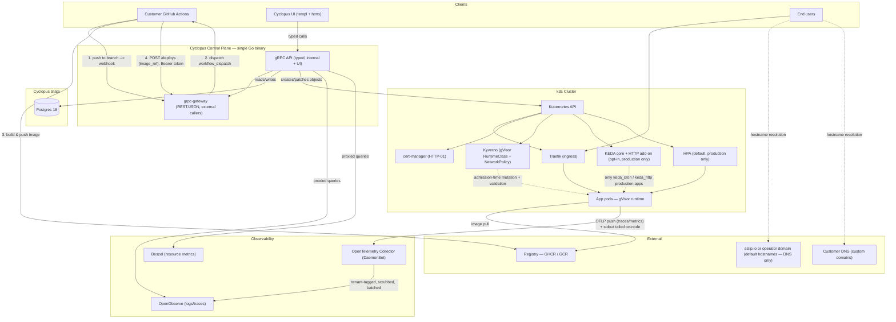
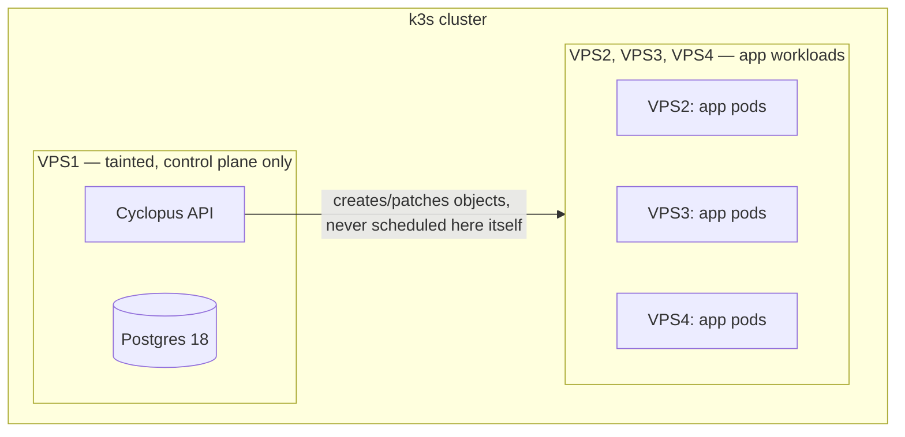

# Cyclopus — Platform Specification

**Status:** v1.2 — implementation-ready
**Scope:** v1 (self-hosted, small teams)

### Phase 0 Errata Precedence

For Phase 0 implementation, executable contracts and Phase 0 decisions correct
any conflicting example or prose in this specification. Precedence is:

1. `workflow/orchestration-job.sql` and executable fixtures under
   `tests/workflow/fixtures/`.
2. `docs/decisions/phase-0-decisions.md`.
3. `workflow/run.yaml`, `workflow/phases.yaml`, and their JSON Schemas.
4. The remaining prose and examples in this document.

Later phases must fold accepted errata back into this canonical specification;
they must not revive lower-precedence text that a Phase 0 contract corrected.

---

## 1. Overview

Cyclopus is a self-hosted platform-as-a-service for small teams: git-push deployment, automatic HTTPS, branch-based preview environments, and per-app workload isolation, running on a customer-owned k3s cluster across one or more VPS instances.

### 1.1 Goals

- A team can go from "empty VPS" to "git-push deploys a live app with HTTPS" using Cyclopus's own install path (bootstrap script + Helm), without hand-writing Kubernetes manifests.
- Every app is isolated from every other app, and from the platform's own control plane, at both the compute/kernel level (gVisor) and the network level (NetworkPolicy) by default. Dropping an app out of the gVisor sandbox is an operator break-glass action, not a customer-facing setting (§7.1).
- Preview environments are automatic and disposable: pushing a non-production branch produces a live URL; deleting the branch tears it down.
- Rollback reuses an already-built image — no rebuild, no CI run, no registry round trip (§3.7).
- The platform is operable by a small team without a dedicated platform engineer.

### 1.2 Deferred to v2

Not gaps — deliberate deferrals, with the v1 shape chosen so each is an additive change rather than a rewrite.

| Deferred | v1 position | Why it waits |
|---|---|---|
| Release-scoped Deployments (true alias-flip rollback) | One mutable Deployment per environment; rollback patches its image and waits for a rollout — §3.7 | Keeping N releases live per environment multiplies resource consumption on a small VPS fleet, which collides directly with preview-environment cost. Worth doing once node capacity is elastic. |
| Granular team RBAC | `orgs` is the tenancy boundary; every member of an org has full access to it, including administrative operations — §9.2 | Per-member roles need a permission model worth designing on its own; the org boundary is what actually isolates tenants. |
| Automatic node-level autoscaling | Pod-level HPA only; node count is fixed at install and changed by re-running the install against the node inventory | Node provisioning is the operator's responsibility on a bring-your-own-VPS install; the platform does not add or remove nodes automatically. |
| Usage analytics and error tracking | Neither ships in v1. Logs and traces (OpenTelemetry Collector → OpenObserve) and resource metrics (Beszel) do — §8 | A known, accepted product gap, not a solved problem being withheld. GlitchTip was evaluated and is explicitly out of scope for this release. |
| Control-plane metrics and alerting | Structured logs only, queryable in OpenObserve — §8.2 | Logs answer "what happened" after someone looks. Nothing pages anyone in v1. Proportionate at 10-15 apps operated by the people deploying to them; the named log events in §8.2 are chosen so alert rules can be layered on later without changing the emitting code. |
| Runtime threat detection (Falco) | gVisor provides prevention; v1 ships no detection layer — §7.1 | Falco answers a question gVisor doesn't ("is a sandboxed workload behaving anomalously?"), but it needs a rule set tuned to real workload behavior to avoid being an alert-noise generator, and under gVisor it needs the `runsc` trace-sink integration rather than the default eBPF driver. Both are work that wants its own pass. |
| Scale-to-zero for preview environments | Previews are pinned at exactly one replica with no autoscaler attached — §4.3 | Depends on the gVisor cold-start measurement in §11; pinning at one replica is the cheap, predictable option until that number exists. |

## 2. System Architecture

Three layers, deliberately separated:

1. **Installation layer** (bootstrap script + Helm) — bootstraps operator-provided VPS nodes and installs platform components. Runs rarely. Never runs as part of a customer's deploy.
2. **Control plane** (Cyclopus API + Postgres) — a single Go binary owning Cyclopus's own state and talking to the Kubernetes API directly.
3. **Data plane** (the k3s cluster) — where customer app pods run, fronted by Traefik, certified by cert-manager, isolated by gVisor + NetworkPolicy, scaled by HPA or KEDA.



### 2.1 Component table

| Component | Technology | Role | Installed |
|---|---|---|---|
| Orchestrator | k3s | Runs everything | Once, via the bootstrap install script on operator-provided VPS nodes. App-workload nodes require nested virtualization (for gVisor `runsc`). Server node: ~2GB RAM / 2 CPU minimum; agent nodes as low as 512MB. Started with `--disable=traefik` and secrets encryption at rest enabled (§9). |
| Ingress | Traefik | Routes hostnames to pods | Once, via Helm. k3s's bundled Traefik is disabled at install so the version is managed explicitly rather than moving with k3s upgrades. |
| TLS | cert-manager | Per-hostname certs via HTTP-01, for both default platform hostnames and customer custom domains. No wildcard certificates and therefore no DNS-01 solver or DNS-provider credential anywhere in v1 (§7.5) | Once, via Helm |
| Isolation — compute | Kyverno + gVisor (`runsc`) RuntimeClass | Kernel-level sandboxing per app pod, mutating *and* validating policies, both fail-closed (§7.1) | Once, via Helm |
| Isolation — network | Kubernetes NetworkPolicy, enforced by k3s's bundled kube-router controller (default) or Calico (optional upgrade for `GlobalNetworkPolicy`) | Default-deny ingress AND egress per app namespace (§7.2) | Built into k3s; Calico optional, Helm |
| Pod autoscaling | Kubernetes HPA | Default for production environments; floor >=1, no scale-to-zero. Not attached to preview environments (§4.3) | Built into k3s |
| Scale-to-zero | KEDA core (cron) + KEDA HTTP Add-on (beta) | **Opt-in per production app** via `scaling_mode` — apps on plain `hpa` never touch this | Once, via Helm |
| Control-plane API | Go + client-go + grpc-go + grpc-gateway | Typed gRPC internally, REST/JSON externally, from one .proto | Cyclopus's own binary, packaged as a Helm chart |
| Control-plane UI | templ + htmx + hand-rolled daisyUI-token CSS (no build step), served via chi | Server-rendered admin dashboard, same Go binary | Same binary |
| Control-plane state | Postgres 18 | Resource records, releases, audit log | Once, via the install script (host package; Helm-external) |
| Config | Viper | Env vars / files / flags, unified | Compiled into the binary |
| Postgres driver | jackc/pgx/v5 | | Compiled into the binary |
| Telemetry ingest | OpenTelemetry Collector (DaemonSet) | Sole telemetry path out of app namespaces: receives OTLP, tails container stdout on-node, stamps tenant identity, scrubs, batches, exports to OpenObserve (§8.1) | Once, via the install script (raw manifests, infra/observability/, pinned in versions.yaml) |
| Logs/traces | OpenObserve | Backed by S3-compatible storage, written only by the Collector, read only via Cyclopus | Once, via the install script (raw manifests, infra/observability/, pinned in versions.yaml) |
| Resource metrics | Beszel | PocketBase-based, proxied through Cyclopus | Once, via the install script (raw manifests, infra/observability/, pinned in versions.yaml) |
| Postgres backup | WAL-G (primary), pgBackRest (heavier alternative) | Streams WAL to `storage_destinations` (S3-compatible); RPO target in §9.1 | Wired by infra/backup/configure_from_db.sh + daily systemd timer (cyclopus-walg-backup.timer) |
| Cluster resource backup | Velero | Kubernetes objects + PVs, secondary to Postgres backup, not a substitute for it | Once, via Helm, optional |
| Default hostnames | sslip.io (default) or operator-owned domain | External, DNS-only. Configured via `kubernetes.preview_hostname_suffix`; both preview and production hostnames use this suffix. sslip.io is not PSL-listed — cert quota is shared globally; configure your own domain for production isolation (§7.5). | Not installed, just used |
| Custom domain DNS | Customer's own DNS provider | Customer-configured; Cyclopus never holds DNS credentials | Not installed by Cyclopus |

### 2.2 Multi-node topology: control plane and app workloads on separate VPS instances

Both directions are standard Kubernetes patterns, not something Cyclopus has to build:

**Pinning the control plane to its own VPS.** VPS1 joins as a k3s server node; VPS2-4 join as agent (worker) nodes. A taint on VPS1 (`cyclopus.app/role=control-plane:NoSchedule`) repels ordinary app pods automatically; only the Cyclopus API and Postgres pods carry the matching toleration plus a `nodeSelector` targeting VPS1's label, so they're the only things that land there. Customer app pods are scheduled onto VPS2-4 by default, since nothing tolerates VPS1's taint.

**Single-node installs are the exception.** The taint applies when worker nodes exist; a single-node install keeps the `cyclopus.app/role=control-plane` label only, because tainting the only node would leave app pods unschedulable. Operators joining workers immediately can pass `CYCLOPUS_CONTROL_PLANE_TAINT=true` to the install script, which taints every control-plane-labeled node and refuses to run on a single-node cluster; otherwise the installer's next-steps output provides the manual command (`k3s kubectl taint nodes <node> cyclopus.app/role=control-plane:NoSchedule`). The multi-node bootstrap path (`infra/bootstrap/k3s_server.sh`) always taints.

**Spreading one app's replicas across VPS2-4.** Also standard, and mostly automatic: once HPA scales an app past one replica, the Kubernetes scheduler distributes those pods across whichever nodes have capacity. For a *guarantee* rather than best-effort spreading (e.g., "this app should survive VPS3 going down"), add a `topologySpreadConstraints` entry to the app's Deployment with `whenUnsatisfiable: DoNotSchedule` — a per-app opt-in field Cyclopus exposes, not a cluster-wide default.



Two operational caveats when adding a worker node:

- **gVisor must be installed per node.** Joining VPS2-4 to the cluster doesn't automatically give them the `gvisor` RuntimeClass — that's a one-time setup step (install `runsc`, register it with containerd) on every node that will run app pods, not something that follows from running `k3s agent`. This belongs in the node-join checklist, not assumed. Because §7.1's validating policy is fail-closed, a node missing `runsc` produces pods that fail to start rather than pods that run unsandboxed — loud, which is the intent.
- **Local persistent volumes don't follow a pod across nodes.** k3s's default storage class (`local-path-provisioner`) ties a volume to the specific node it was created on. If an app pod using a local PV gets rescheduled to a different node after a failure, it doesn't take that volume with it. The design already assumes apps bring their own external database rather than holding state in-cluster, so this is unlikely to matter for most apps — but any app that does mount a local PV must be flagged in the UI as not resilient to node loss unless a distributed block storage layer (e.g. Longhorn) replaces the default provisioner for that volume. This applies to Cyclopus's own Postgres too; see §9.1.

### 2.3 Control-plane availability

v1 runs a single control-plane instance. At the target scale — roughly 10-15 apps — this is proportionate, and the failure mode is bounded and understood: a control-plane outage pauses new deploys and UI access but does not affect already-running customer apps, which are served by Traefik directly and never route through the Cyclopus API. Data-loss risk is bounded separately by §9.1's Postgres backup story, which applies regardless of instance count.

Because restarts of a single instance are routine rather than exceptional, every piece of in-flight state must survive one. The deploy lock is a lease with an expiry, not a flag (§4.3), and startup runs a sweep for work orphaned by the previous process (§4.7).

Postgres 18 and the stateless API design leave the door open to multiple API replicas without a rewrite; §2.2's node pinning is the cheap partial win available today, since it means app-workload resource pressure can't be what takes the control plane down.

## 3. Key decisions

### 3.1 Control-plane language: Go

Reference implementation ecosystem for Kubernetes tooling (`client-go`); every dependency in this spec (Traefik, cert-manager, Kyverno, KEDA) is Go. Paired with chi + templ + htmx + modular hand-rolled CSS (daisyUI token naming, no Node toolchain) for the UI and grpc-go + grpc-gateway for the API, the whole control plane is one dependency-free binary.

**Rejected:** Iris, despite being a technically functional Go framework — a long-running, well-documented pattern of the maintainer mishandling community-reported issues (deleting critical bug reports, disputing its own linked benchmark results, banning users who raised problems) makes it a poor foundation for infrastructure other people will depend on, independent of its code quality.

### 3.2 Deploy mechanism: imperative API, not Helm-per-app, not a full operator

The API directly creates/patches native Kubernetes objects on every request. Consequence: Cyclopus does not self-heal from manual cluster drift. Upside realized in §9: because Postgres is the source of truth, every Kubernetes object is regenerable from it, which is what makes a clean DR story possible.

### 3.3 Isolation: gVisor + Kyverno (compute) + NetworkPolicy (network) — two distinct axes, both required

gVisor solves kernel/compute isolation only. Network isolation is a separate mechanism (§7.2), enforced by k3s's bundled kube-router NetworkPolicy controller by default, with Calico as the documented upgrade path if `GlobalNetworkPolicy`-style cluster-wide policy management becomes valuable at scale.

### 3.4 Scaling: HPA by default, KEDA opt-in per app — mutually exclusive by necessity

Applies to **production environments only**. Preview environments are pinned at exactly one replica with no autoscaling object attached at all (§4.3), so nothing below applies to them.

KEDA core handles cron-triggered scale-to-zero natively and stably. The KEDA HTTP Add-on handles HTTP-triggered scale-to-zero via an interceptor/scaler/operator triple — **officially beta**, accepted as a reasonable risk with a documented fallback: any app can be flipped to `scaling_mode: hpa` if the Add-on misbehaves. This only applies to apps that opt in (`keda_cron` or `keda_http`) — apps on the default `hpa` mode never route through KEDA or its interceptor at all.

**`scaling_mode` is exclusive because the objects are.** A KEDA `ScaledObject` creates and owns its own HPA for the target Deployment. Two controllers managing autoscaling for the same Deployment fight each other, so exclusivity is a correctness requirement, not a simplification.

The composition case — "hold a floor of one replica, but pre-scale ahead of a known traffic window" — does not need both, because a single `ScaledObject` accepts multiple triggers. A cron trigger and a CPU trigger coexist on one object, with `minReplicaCount` setting the floor. Accordingly:

- `min_replicas` / `max_replicas` on `apps` feed whichever object gets created: the HPA's `minReplicas`/`maxReplicas` in `hpa` mode, the `ScaledObject`'s `minReplicaCount`/`maxReplicaCount` in either KEDA mode.
- `hpa` mode requires `min_replicas >= 1` — enforced by a table constraint (§5), since HPA cannot scale to zero.
- Scale-to-zero is therefore the combination `scaling_mode != 'hpa' AND min_replicas = 0`, not a separate fourth mode.

**Resource requests are mandatory, not optional.** HPA computes CPU utilization as a percentage of a pod's CPU *request*; with no request there is no denominator and the HPA reports `<unknown>` and never scales. Every app therefore carries non-null CPU and memory requests and limits (§5), and the HPA targets `averageUtilization` against `hpa_target_cpu_percent`. This is also what keeps the scheduler honest: without requests, Kubernetes treats every app as costless, overcommits nodes freely, and gives every pod BestEffort QoS — first in line for OOM kill. On a shared VPS fleet running untrusted tenants that is a routine outage, not an edge case.

### 3.5 Database: Postgres 18

Native `uuidv7()` for time-sortable Release IDs, and a path to multiple API replicas without SQLite's single-writer constraint.

### 3.6 API shape: gRPC (typed) + grpc-gateway (REST/JSON), not REST-only

One `.proto` definition is the source of truth. Internal callers (the UI, in-process or over localhost) and any future CLI get full typed gRPC — request/response shapes are compile-time checked, not runtime-hoped-for. External callers (CI systems calling the deploy endpoint) get the REST/JSON surface that grpc-gateway auto-generates from the same definition, so `curl` still works and there's exactly one schema to maintain, not two.

### 3.7 Release model: one mutable Deployment per environment

Each environment has exactly one Deployment. Deploying patches its pod template to a new `image_ref` and waits for the rollout; rolling back patches it to a prior release's `image_ref` and waits for that rollout. Both are ordinary `RollingUpdate` rollouts with the same characteristics.

The consequence to be honest about: **rollback is fast because it skips the build, not because it skips the rollout.** It costs one rolling update — seconds to a minute depending on image pull cache and readiness probe timing — not the sub-second traffic flip that a true alias switch would give. §1.1 claims exactly this and no more.

`aliases` is retained as the hostname-to-release record, but in v1 it is bookkeeping written in the same transaction as the Deployment patch, not the routing mechanism: traffic reaches pods via Ingress → Service → the environment's single Deployment. The table earns its place as the seam for v2's release-scoped Deployments (§1.2), where flipping `aliases.release_id` becomes the actual traffic-moving operation and rollback becomes genuinely instant. Building that now would mean keeping N Deployments live per environment, which multiplies exactly the resource consumption §4.3 is trying to contain.

## 4. Request and event lifecycles

### 4.1 Setting up a Project

**GitHub App permissions.** Each operator registers their own GitHub App (Cyclopus is self-hosted; there is no shared vendor App). Exactly these permissions, no more — verified against GitHub's current REST documentation:

| Permission | Level | Needed for |
|---|---|---|
| Metadata | Read | Mandatory for every GitHub App. |
| Contents | Read | Reading the repository and resolving the default branch. |
| Actions | **Write** | `POST /repos/{owner}/{repo}/actions/workflows/{id}/dispatches` requires Actions **write** — read is only enough to list workflows and inspect runs. This is the permission that lets Cyclopus decide when a build runs (§4.2). |
| Secrets | **Write** | Creating and updating the `CYCLOPUS_API_TOKEN` repository secret. Writing a secret also requires fetching the repository public key to encrypt it, which write covers. |

**Webhook events subscribed:** `push` (§4.2, §4.3) and `delete` (§4.4). `workflow_run` is optional and only worth subscribing to if the UI is to show build progress before the deploy callback arrives.

**Not requested, deliberately:** Administration, Workflows (which permits modifying workflow *files*, not running them), Environments, Packages, Deployments, and every organization-level permission. Cyclopus dispatches workflows and writes one secret; it has no reason to alter repository settings or workflow definitions.

Note that Actions-write plus Secrets-write is a genuinely powerful pair — it is what §7.7's trust boundary is describing, and it is the floor for this design rather than an over-request.

User login via GitHub OAuth (§9) is a separate user-to-server flow needing only the user's identity and email; it does not widen the installation's repository permissions.

1. Admin initiates a GitHub App install (not raw OAuth — narrower scopes, per-installation).
2. Cyclopus stores a `git_connections` row.
3. Admin creates a `registries` row (GHCR or GCR + credential, stored as a Kubernetes `imagePullSecret`; plaintext never touches Postgres).
4. Admin creates `projects` and `apps` rows, including the app's container port, health check path, and resource requests — all required, all defaulted (§5).
5. Cyclopus writes a `CYCLOPUS_API_TOKEN` repo secret into the connected repo automatically, using the GitHub App's write-secrets permission.

### 4.2 Deploying

**Cyclopus does not build images, but it does orchestrate the build.**

1. A `push` webhook (any branch) arrives at Cyclopus, signature-verified. Pushes authored by Cyclopus's own GitHub App installation identity are ignored, so a workflow that commits back to the repo — version bumps, changelogs, formatters, lockfile updates — cannot trigger a new dispatch and loop (§4.3 also imposes a per-branch rate ceiling as a backstop).
2. Cyclopus dispatches the customer's configured GitHub Actions workflow via GitHub's `workflow_dispatch` API, using the GitHub App installation's permissions. The request includes required `orchestration_job_id` and immutable `commit_sha` inputs. The workflow must checkout that exact SHA and attest that `HEAD` equals it before building; Cyclopus correlation also requires GitHub's observed `head_sha` to match. Cyclopus decides when a build runs — not an independent `on: push` trigger the workflow owns itself.
3. The workflow builds the image and pushes it to the app's configured Registry (GHCR/GCR).
4. The workflow's final step calls:
   ```
   POST /v1/environments/{id}/deploys
   Authorization: Bearer <cyclopus api token, scoped to this app>
   { "image_ref": "ghcr.io/acme/api@sha256:..." }
   ```
5. **Cyclopus validates `image_ref` server-side before accepting it.** The registry host and repository path must match the app's `registries.registry_url` and `apps.image_repository`, and the reference must be a digest — tags are rejected outright, since a tag is mutable and defeats the point of recording an immutable release. A token scoped to `deploy:app_id` therefore cannot be used to run arbitrary images; see §7.7 for what it *can* still do.
6. Cyclopus creates a `releases` row (`status: pending`, `id` a `uuidv7()`) and acquires the environment's deploy lease (§4.3).
7. Cyclopus creates/patches the Deployment, Service, and Ingress, plus — for production environments only — either an HPA or a KEDA `ScaledObject` depending on `scaling_mode`. The Deployment carries:
   - `runtimeClassName` from `apps.runtime_class` (§7.1)
   - `RollingUpdate` strategy — rolling deploys are the default, not an opt-in
   - resource requests and limits from `apps` (§3.4)
   - a readiness probe on `health_check_path`:`container_port`
   - `progressDeadlineSeconds` set from `apps.deploy_timeout_seconds` (§4.7)
   - an annotation on the pod template holding a hash of the environment's env-var Secret, so a change to any env var produces a new pod template and therefore an automatic rollout (§4.8)
8. cert-manager issues a cert if one doesn't exist for the hostname; Traefik picks up the route.
9. **Ready means both**: the Deployment's rollout has completed (`observedGeneration` current, updated replicas available) *and* the readiness probe is passing on those pods. Rollout completion alone is not sufficient — it would flip the alias to a release that isn't serving.
10. On ready, Cyclopus points the environment's `aliases` row at the new release and marks it `live` in the same transaction as the lease release; the previous release becomes `superseded`, not deleted.
11. An `audit_events` row is written and a `deploy.succeeded` webhook event is emitted.

Failure and timeout handling is in §4.7. **No install tooling (bootstrap script or Helm), anywhere in this flow.** In-cluster image building is out of scope by design — Cyclopus dispatches customer CI to build and never builds images itself.

### 4.3 Branch push → preview environment

Preview environments are enabled per app via `apps.previews_enabled`. When false, non-production branch pushes are acknowledged and dropped — no dispatch, no build, no environment. This is the only preview access control v1 offers, and it is all-or-nothing per app.

1. `push` webhook arrives for a non-production branch, on an app with previews enabled.
2. If no `environments` row exists for this `(app, branch)` pair, Cyclopus creates one, subject to `apps.max_preview_environments` — at the cap, the push is rejected with a clear error rather than silently queued.
3. **Namespace creation is fail-safe ordered, not atomic.** There is no transaction spanning Postgres and the Kubernetes API, and no atomic multi-object apply in the Kubernetes API either, so the guarantee is achieved by ordering instead:
   1. Create the namespace carrying the label `cyclopus.app/policies-pending=true`.
   2. A Kyverno **validating** policy denies all pod creation in any namespace carrying that label.
   3. Apply both NetworkPolicies (§7.2) and confirm they exist by reading them back.
   4. Remove the label.

   A failure at any step leaves an empty, unusable namespace rather than an unprotected running one. The environment is not marked usable and no deploy proceeds until step 4 completes.
4. §4.2 runs as normal against this environment, with two preview-specific differences: the Deployment is pinned at exactly one replica with **no HPA and no ScaledObject attached** regardless of the app's `scaling_mode`, and the namespace receives a `ResourceQuota` and `LimitRange` derived from the app's per-pod limits. A preview cannot outgrow one pod's worth of resources, so preview sprawl cannot starve production.
5. Cyclopus generates the preview hostname from the environment's `preview_slug` (§7.5) and requests a cert via cert-manager's HTTP-01 challenge.
6. Subsequent pushes to the same branch reuse the same environment, slug, hostname, and certificate — no new namespace and no new certificate per push.

**Concurrency rule.** An in-progress build/deploy for a branch always runs to completion and is never canceled mid-flight. Pushes arriving while one is running are queued, not run in parallel. If more than one commit queues before the in-progress deploy finishes, they coalesce: only the most recently queued commit triggers the next build, since deploying an intermediate, already-superseded commit serves no purpose for a branch environment.

Three fields on `environments` implement this without a separate queue table:

- `in_progress_release_id` — non-null means a deploy is running.
- `lock_acquired_at` — when it was acquired. **The lock is a lease, not a flag.** Past `deploy_timeout_seconds`, it is considered expired and may be broken by the sweep in §4.7. Without this, a single control-plane crash mid-deploy would leave the environment permanently unable to deploy, with no error surfaced — new pushes would queue correctly behind a deploy that will never finish.
- `pending_commit_sha` — overwritten, not appended, by each push arriving during a run.

Draining `pending_commit_sha` on completion must be a **single atomic statement**:

```sql
UPDATE environments
   SET pending_commit_sha = NULL
 WHERE id = $1
RETURNING WITH (OLD AS old_row, NEW AS new_row)
          old_row.pending_commit_sha AS taken_sha,
          new_row.pending_commit_sha AS remaining_sha;
```

Implemented as a separate read then write, a push arriving between the two is silently lost — the developer sees a green CI run and no deploy, with nothing anywhere recording that a commit was dropped.

The pre-update `taken_sha` is the commit to promote. `remaining_sha` must be
`NULL`; returning the unqualified post-update column would return only `NULL`
and is not a valid take-and-clear implementation. This PostgreSQL 18 contract
is executable in `tests/workflow/fixtures/pending_sha_pg18.sql`.

**Rate ceiling.** Dispatches are capped per `(app, branch)` per hour. This is a backstop against dispatch loops that survive the author check in §4.2 step 1, and against a script pushing in a tight loop; exceeding it defers rather than drops, and logs.

### 4.4 Teardown

Preview environments are torn down by either of two triggers:

- **Branch deleted.** A GitHub `delete` webhook arrives.
- **Idle expiry.** No release has been created for the environment in `apps.preview_idle_ttl_hours`. Idleness is measured by last deploy, not by traffic — traffic-based idleness needs ingress-level accounting that v1 doesn't have, and abandoned-but-undeleted branches are the case this exists to catch.

In both cases: Cyclopus deletes the Kubernetes namespace (cascading to Deployment, Service, Ingress, cert, NetworkPolicy, ResourceQuota), then sets `environments.torn_down_at`. The row is retained for audit history. A later push to a torn-down branch creates a fresh environment with a **new** slug and hostname — slugs are never reused.

### 4.5 Rollback

1. Admin selects a prior `releases` row, within the app's retention window (§4.9).
2. Cyclopus patches the environment's Deployment back to that release's `image_ref` and waits for the rollout, using the same readiness definition as §4.2 step 9.
3. On ready, `aliases.release_id` is updated to that release in the same transaction; the rolled-back-from release becomes `superseded`.
4. `audit_events` logs the rollback with before/after release IDs.

If the rollback rollout itself fails, §4.7 applies unchanged — the environment stays on whatever was serving before the rollback was attempted.

### 4.6 Deleting an org, project, or app

**Phase 0 erratum:** deletion is an API-level audited tombstone operation. This paragraph supersedes the physical-deletion wording below for Phase 0: org, project, app, environment, release, reconciliation, and audit rows are preserved.

Order of operations:

1. Enumerate every descendant `environments` row.
2. Delete each Kubernetes namespace and wait for termination.
3. Revoke scoped `api_tokens` and remove the `CYCLOPUS_API_TOKEN` repo secret via the GitHub App.
4. The caller explicitly confirms external credential revocation completed.
5. Atomically set the top-level row's revocation timestamp and `deleted_at`, and write `audit_events`.

If step 2 fails for any namespace, or credential revocation is unconfirmed, the tombstone is rejected. Rows are never removed: Postgres remains the historical map to the derived infrastructure (§3.2).

### 4.7 Deploy failure, timeout, and orphan recovery

Modeled on Vercel's behavior: a failed deploy never takes down what's already serving, and nothing retries automatically.

**Timeout is enforced by Kubernetes, not by a timer in the API.** The Deployment carries `progressDeadlineSeconds = apps.deploy_timeout_seconds` (default 600). If the rollout stalls — image pull failure, crash loop, readiness probe never passing — Kubernetes sets a `ProgressDeadlineExceeded` condition, which Cyclopus watches for. This survives a control-plane restart, which a timer in the API process would not.

On failure or timeout:

1. The release is marked `failed`.
2. The Deployment's pod template is patched back to the previously `live` release's `image_ref`. Under `RollingUpdate` the old pods were never torn down — new ones never became ready — so this is a cheap correction, not a recovery.
3. `aliases` is **not** moved. The previous release stays `live` and keeps serving.
4. If there is no previous live release (a first deploy that failed), the environment simply has no live release and no alias. The Deployment is left in place at zero healthy pods so its events remain inspectable; nothing is served at the hostname.
5. The deploy lease is released, and `pending_commit_sha` is drained as normal — a failed deploy does not block the next one.
6. An `audit_events` row is written and a `deploy.failed` webhook event is emitted, carrying the release ID and the Kubernetes condition that caused it.

**No automatic retry.** The next push retries naturally, which is both the simplest behavior and the one least likely to hammer a broken image.

**Startup sweep.** On boot, the API scans for releases left in `pending` or `deploying` whose environment lease has expired, marks them `failed`, applies steps 2-6, and releases the lease. This is what makes §2.3's single-instance control plane safe to restart at any moment.

### 4.8 Environment variable changes

Writing a new value updates the environment's Kubernetes Secret, which alone does **not** restart running pods — `envFrom` values are read at container start. Cyclopus therefore recomputes the Secret's hash and writes it into the Deployment's pod template annotation (§4.2 step 7), producing a new template revision and an automatic rolling update. Changing an env var is a deploy: it appears in the UI as one, it respects the same lease and readiness rules, and it can fail and roll back per §4.7.

### 4.9 Release retention

`releases` rows are retained indefinitely — they are audit history and cost nothing. What is bounded is **rollback reach**: the most recent `apps.release_retention_count` releases per environment (default 5, configurable per app) are guaranteed rollback-able. Older releases remain visible in history but are marked outside the retention window, and their images are eligible for registry garbage collection.

Cyclopus does not delete images from the registry. Registry retention is the customer's own policy on their own GHCR/GCR account; Cyclopus's guarantee is only that it will not offer a rollback target it has told the customer is collectable.

## 5. Data model

```sql
CREATE TABLE orgs (
  id UUID PRIMARY KEY DEFAULT uuidv7(),
  name TEXT NOT NULL,
  slug TEXT NOT NULL UNIQUE,
  created_at TIMESTAMPTZ NOT NULL DEFAULT now()
);

-- First-run flow: creating the first user auto-creates this row,
-- named 'My Organization', with that user as its first member.

CREATE TABLE users (
  id UUID PRIMARY KEY DEFAULT uuidv7(),
  org_id UUID NOT NULL REFERENCES orgs(id) ON DELETE CASCADE,
  email TEXT NOT NULL UNIQUE,
  password_hash TEXT, -- nullable: set on first-run local signup, null if github_user_id is used instead
  github_user_id BIGINT,
  created_at TIMESTAMPTZ NOT NULL DEFAULT now()
);

CREATE TABLE api_tokens (
  id UUID PRIMARY KEY DEFAULT uuidv7(),
  user_id UUID NOT NULL REFERENCES users(id) ON DELETE CASCADE,
  name TEXT NOT NULL,
  token_hash TEXT NOT NULL,
  scopes TEXT[] NOT NULL DEFAULT '{}', -- e.g. 'deploy:app_id'
  expires_at TIMESTAMPTZ,
  created_at TIMESTAMPTZ NOT NULL DEFAULT now(),
  last_used_at TIMESTAMPTZ
);

CREATE TABLE git_connections (
  id UUID PRIMARY KEY DEFAULT uuidv7(),
  org_id UUID NOT NULL REFERENCES orgs(id) ON DELETE CASCADE,
  provider TEXT NOT NULL DEFAULT 'github',
  installation_id BIGINT NOT NULL,
  repo_full_name TEXT NOT NULL,
  default_branch TEXT NOT NULL DEFAULT 'main',
  webhook_secret_ref TEXT NOT NULL,
  created_at TIMESTAMPTZ NOT NULL DEFAULT now()
);

CREATE TABLE registries (
  id UUID PRIMARY KEY DEFAULT uuidv7(),
  org_id UUID NOT NULL REFERENCES orgs(id) ON DELETE CASCADE,
  provider TEXT NOT NULL CHECK (provider IN ('ghcr', 'gcr', 'ecr', 'other')),
  registry_url TEXT NOT NULL,
  credential_secret_ref TEXT NOT NULL,
  created_at TIMESTAMPTZ NOT NULL DEFAULT now()
);

CREATE TABLE projects (
  id UUID PRIMARY KEY DEFAULT uuidv7(),
  org_id UUID NOT NULL REFERENCES orgs(id) ON DELETE CASCADE,
  name TEXT NOT NULL,
  slug TEXT NOT NULL,
  git_connection_id UUID REFERENCES git_connections(id) ON DELETE SET NULL,
  created_at TIMESTAMPTZ NOT NULL DEFAULT now(),
  UNIQUE (org_id, slug)
);

CREATE TABLE apps (
  id UUID PRIMARY KEY DEFAULT uuidv7(),
  project_id UUID NOT NULL REFERENCES projects(id) ON DELETE CASCADE,
  name TEXT NOT NULL,
  slug TEXT NOT NULL, -- display identity, unique within its project

  -- Hostname identity, unique across the whole install. Separate from `slug`
  -- because slug is only unique per project, while hostnames are flat: two
  -- projects each with an app slugged 'api' would otherwise generate the same
  -- production hostname and collide on aliases.hostname (§7.5).
  -- Defaults to slug, auto-suffixed on collision, independently editable.
  hostname_label TEXT NOT NULL UNIQUE
    CHECK (hostname_label ~ '^[a-z0-9]([a-z0-9-]{0,61}[a-z0-9])?$'),

  registry_id UUID REFERENCES registries(id) ON DELETE RESTRICT,
  image_repository TEXT, -- enforced against submitted image_ref (§4.2 step 5)

  -- Serving. Required: Cyclopus cannot construct a Service or a readiness
  -- probe without them, and "ready" is undefined without a probe (§4.2).
  container_port INT NOT NULL DEFAULT 8080 CHECK (container_port BETWEEN 1 AND 65535),
  health_check_path TEXT NOT NULL DEFAULT '/',

  -- Scaling (production environments only; previews are pinned at 1 — §4.3)
  scaling_mode TEXT NOT NULL DEFAULT 'hpa' CHECK (scaling_mode IN ('hpa', 'keda_cron', 'keda_http')),
  min_replicas INT NOT NULL DEFAULT 1 CHECK (min_replicas >= 0),
  max_replicas INT NOT NULL DEFAULT 3 CHECK (max_replicas >= 1),
  hpa_target_cpu_percent INT NOT NULL DEFAULT 70 CHECK (hpa_target_cpu_percent BETWEEN 1 AND 100),

  -- Resources. Non-null by design: HPA computes utilization as a percentage
  -- of the CPU request, so a null request means the default scaling mode
  -- silently does nothing (§3.4). Integer units, not k8s quantity strings,
  -- so they are validatable in the database rather than at parse time.
  cpu_request_millicores INT NOT NULL DEFAULT 100 CHECK (cpu_request_millicores > 0),
  cpu_limit_millicores INT NOT NULL DEFAULT 1000 CHECK (cpu_limit_millicores > 0),
  memory_request_mib INT NOT NULL DEFAULT 128 CHECK (memory_request_mib > 0),
  memory_limit_mib INT NOT NULL DEFAULT 512 CHECK (memory_limit_mib > 0),

  -- Previews
  previews_enabled BOOLEAN NOT NULL DEFAULT true,
  max_preview_environments INT NOT NULL DEFAULT 10 CHECK (max_preview_environments >= 0),
  preview_idle_ttl_hours INT NOT NULL DEFAULT 168 CHECK (preview_idle_ttl_hours > 0),

  -- Deploy behavior
  deploy_timeout_seconds INT NOT NULL DEFAULT 600 CHECK (deploy_timeout_seconds > 0),
  release_retention_count INT NOT NULL DEFAULT 5 CHECK (release_retention_count >= 1),

  -- Operator break-glass only; not customer-settable in the UI (§7.1)
  runtime_class TEXT NOT NULL DEFAULT 'gvisor' CHECK (runtime_class IN ('gvisor', 'runc')),

  ci_workflow_id TEXT, -- the GitHub Actions workflow Cyclopus dispatches
  created_at TIMESTAMPTZ NOT NULL DEFAULT now(),

  UNIQUE (project_id, slug),
  CHECK (max_replicas >= GREATEST(min_replicas, 1)),
  CHECK (cpu_limit_millicores >= cpu_request_millicores),
  CHECK (memory_limit_mib >= memory_request_mib),
  -- HPA cannot scale to zero; scale-to-zero requires a KEDA mode (§3.4)
  CONSTRAINT hpa_requires_floor CHECK (scaling_mode <> 'hpa' OR min_replicas >= 1)
);

CREATE TABLE environments (
  id UUID PRIMARY KEY DEFAULT uuidv7(),
  app_id UUID NOT NULL REFERENCES apps(id) ON DELETE CASCADE,
  branch TEXT NOT NULL, -- 'main' (production) or any other branch name (preview)
  kind TEXT NOT NULL CHECK (kind IN ('production', 'preview')),

  -- Generated word-pair slug (§7.5). Sole source of both the namespace name
  -- and the hostname label, so neither depends on sanitizing a branch name
  -- into something DNS-safe. Never reused, including after teardown.
  preview_slug TEXT UNIQUE,
  namespace TEXT NOT NULL UNIQUE,

  -- Deploy lease + coalescing slot (§4.3). in_progress_release_id is added
  -- after `releases` exists, below.
  lock_acquired_at TIMESTAMPTZ,
  pending_commit_sha TEXT,

  created_at TIMESTAMPTZ NOT NULL DEFAULT now(),
  torn_down_at TIMESTAMPTZ,
  UNIQUE (app_id, branch),
  CHECK (kind <> 'preview' OR preview_slug IS NOT NULL)
);

CREATE TABLE releases (
  id UUID PRIMARY KEY DEFAULT uuidv7(),
  environment_id UUID NOT NULL REFERENCES environments(id) ON DELETE CASCADE,
  image_ref TEXT NOT NULL, -- always a digest reference; tags rejected (§4.2)
  git_commit_sha TEXT,
  triggered_by_user_id UUID REFERENCES users(id),
  status TEXT NOT NULL DEFAULT 'pending' CHECK (status IN ('pending','deploying','live','failed','superseded')),
  failure_reason TEXT, -- the Kubernetes condition that caused it (§4.7)
  created_at TIMESTAMPTZ NOT NULL DEFAULT now()
);

-- Added after `releases` exists: environments <-> releases is a mutual
-- reference, so this column cannot be declared inline above.
-- Non-null == a deploy is in flight. Combined with lock_acquired_at this
-- is a lease, not a flag: past the app's deploy timeout it is breakable
-- by the startup sweep (§4.7), so a control-plane crash cannot deadlock
-- an environment permanently.
ALTER TABLE environments
  ADD COLUMN in_progress_release_id UUID REFERENCES releases(id) ON DELETE SET NULL;

CREATE TABLE aliases (
  id UUID PRIMARY KEY DEFAULT uuidv7(),
  environment_id UUID NOT NULL REFERENCES environments(id) ON DELETE CASCADE,
  hostname TEXT NOT NULL UNIQUE,
  release_id UUID NOT NULL REFERENCES releases(id),
  updated_at TIMESTAMPTZ NOT NULL DEFAULT now()
);
-- v1: records which release is currently serving at this hostname, written
-- in the same transaction as the Deployment patch. It is bookkeeping, not
-- the routing mechanism — traffic goes Ingress -> Service -> the single
-- Deployment (§3.7). The table exists in this shape because it becomes the
-- actual traffic-moving control in v2's release-scoped model.

CREATE TABLE domains (
  id UUID PRIMARY KEY DEFAULT uuidv7(),
  app_id UUID NOT NULL REFERENCES apps(id) ON DELETE CASCADE,
  hostname TEXT NOT NULL UNIQUE,
  verification_method TEXT NOT NULL CHECK (verification_method IN ('dns_txt','cname')),
  verification_token TEXT, -- the per-domain random value for the _cyclopus-challenge TXT record
  verified_at TIMESTAMPTZ,
  created_at TIMESTAMPTZ NOT NULL DEFAULT now()
);

CREATE TABLE env_vars (
  id UUID PRIMARY KEY DEFAULT uuidv7(),
  environment_id UUID NOT NULL REFERENCES environments(id) ON DELETE CASCADE,
  key TEXT NOT NULL,
  secret_ref TEXT NOT NULL, -- k8s Secret reference; plaintext never lands here
  is_secret BOOLEAN NOT NULL DEFAULT true,
  created_at TIMESTAMPTZ NOT NULL DEFAULT now(),
  UNIQUE (environment_id, key)
);

CREATE TABLE storage_destinations (
  id UUID PRIMARY KEY DEFAULT uuidv7(),
  org_id UUID NOT NULL REFERENCES orgs(id) ON DELETE CASCADE,
  purpose TEXT NOT NULL CHECK (purpose IN ('postgres_backup','log_drain','observability_backing')),
  endpoint TEXT NOT NULL,
  bucket TEXT NOT NULL,
  credential_secret_ref TEXT NOT NULL,
  created_at TIMESTAMPTZ NOT NULL DEFAULT now()
);
-- v1 scope: platform-internal only, not a customer-facing feature.
-- Schema is deliberately generic (purpose enum, not a hardcoded
-- single-use table) so exposing this to customers later is a scope
-- change, not a rewrite.

CREATE TABLE webhooks (
  id UUID PRIMARY KEY DEFAULT uuidv7(),
  org_id UUID NOT NULL REFERENCES orgs(id) ON DELETE CASCADE,
  target_url TEXT NOT NULL,
  events TEXT[] NOT NULL DEFAULT '{}', -- empty means all (§6.1)
  secret TEXT NOT NULL,
  consecutive_failures INT NOT NULL DEFAULT 0,
  disabled_at TIMESTAMPTZ, -- auto-set after 20 consecutive failures (§6.1)
  created_at TIMESTAMPTZ NOT NULL DEFAULT now()
);

-- Retry state is persisted rather than held in memory so that pending
-- deliveries survive a control-plane restart, which §2.3 treats as routine.
-- The startup path that sweeps deploy leases also resumes these.
CREATE TABLE webhook_deliveries (
  id UUID PRIMARY KEY DEFAULT uuidv7(), -- sent as X-Cyclopus-Delivery, stable across retries
  webhook_id UUID NOT NULL REFERENCES webhooks(id) ON DELETE CASCADE,
  event TEXT NOT NULL,
  payload JSONB NOT NULL,
  attempt INT NOT NULL DEFAULT 0,
  next_attempt_at TIMESTAMPTZ,   -- null once terminal
  last_status_code INT,
  last_error TEXT,
  delivered_at TIMESTAMPTZ,
  abandoned_at TIMESTAMPTZ,      -- set after the 6th failed attempt
  created_at TIMESTAMPTZ NOT NULL DEFAULT now()
);

CREATE INDEX ON webhook_deliveries (next_attempt_at)
  WHERE delivered_at IS NULL AND abandoned_at IS NULL;

CREATE TABLE audit_events (
  id UUID PRIMARY KEY DEFAULT uuidv7(),
  org_id UUID NOT NULL REFERENCES orgs(id) ON DELETE CASCADE,
  actor_user_id UUID REFERENCES users(id),
  action TEXT NOT NULL,
  target_type TEXT NOT NULL,
  target_id UUID NOT NULL,
  before JSONB,
  after JSONB,
  created_at TIMESTAMPTZ NOT NULL DEFAULT now()
);
```

## 6. API surface (v1)

One `.proto` definition (§3.6), served as typed gRPC internally and as REST/JSON via grpc-gateway externally.

**In v1:** Orgs, Projects, Apps, Environments, Releases, Aliases, Domains + DNS, Certs (read-only), Env vars, Git connections, Registries, Logs, Metrics, Webhooks, Authentication (tokens), Audit events, User, plus the reconcile endpoint (§9.2).

**Deferred, shape reserved:** Team-as-RBAC, generalized Drains, Rolling releases, Checks, Artifacts, integrated registry, custom routing rules.

The `.proto` itself — message shapes, field numbering, error model, pagination — is written during implementation rather than specified here. The categories above and the data model in §5 constrain it enough that writing it out twice would mean maintaining it twice. The one contract fixed in advance is §6.1, because it is consumed by systems outside Cyclopus and cannot be changed unilaterally later.

### 6.1 Outbound webhooks

The only Cyclopus API surface that third-party systems depend on, and therefore the only one whose shape is pinned before implementation.

**Events.** `deploy.started`, `deploy.succeeded`, `deploy.failed`, `rollback.completed`, `environment.created`, `environment.torn_down`. Subscriptions are per-endpoint via `webhooks.events`; an empty array means all.

**Request.** `POST` to `target_url`, `Content-Type: application/json`, with headers:

| Header | Contents |
|---|---|
| `X-Cyclopus-Event` | Event name, e.g. `deploy.succeeded` |
| `X-Cyclopus-Delivery` | `uuidv7()` of this delivery attempt — stable across retries |
| `X-Cyclopus-Timestamp` | Unix seconds at first send |
| `X-Cyclopus-Signature` | `sha256=<hex>` |

**Signature.** HMAC-SHA256 over the exact bytes `{timestamp}.{raw body}`, keyed by `webhooks.secret`. Signing timestamp-plus-body rather than body alone is what lets a receiver reject replays: consumers should verify with a constant-time compare and drop deliveries whose timestamp is outside a five-minute window. Receivers must verify against the raw body, before any JSON parse or re-serialization.

**Delivery semantics.** At-least-once, unordered. Both properties are load-bearing for consumers: retries mean the same `X-Cyclopus-Delivery` can arrive twice and handlers must be idempotent, and the absence of ordering means a `deploy.succeeded` for a later release may arrive before an earlier one's. Payloads therefore always carry the release and environment IDs plus an event timestamp, so a consumer can order and deduplicate for itself. Cyclopus makes no ordering guarantee it would have to build a queue to keep.

**Retries.** Success is any 2xx within a 10-second timeout. Failures retry 6 times with backoff at 10s, 1m, 5m, 30m, 2h, 6h — roughly nine hours of tolerance for a receiver being down, then the delivery is abandoned. Retry state lives in `webhook_deliveries` (§5), not in memory, so it survives the restarts that §2.3 treats as routine; the same startup path that sweeps deploy leases resumes pending deliveries.

**Auto-disable.** After 20 consecutive failed deliveries an endpoint is marked `disabled_at` and stops receiving, with a `webhook.disabled` log event (§8.2) and a UI flag. Re-enabling is manual. This exists because a permanently dead endpoint otherwise generates unbounded retry work forever.

## 7. Isolation and security model

### 7.1 Compute isolation

Every app pod runs under the `gvisor` RuntimeClass. Enforcement is deliberately two policies, not one, and both fail closed:

- A **mutating** Kyverno policy injects `runtimeClassName` from the app's configuration, with `failurePolicy: Fail`.
- A **validating** Kyverno policy **rejects** any pod in an app namespace whose `runtimeClassName` does not match what Cyclopus expects for that app, also with `failurePolicy: Fail`.

The validating half is the one that matters. A mutating policy alone is a fail-open isolation boundary: if the webhook is unreachable — Kyverno restarting, mid-upgrade, an expired serving cert, a node partition — pods are admitted *without* the RuntimeClass and run on the host runtime, with no error, no alert, and nothing afterward to distinguish them from correctly sandboxed pods. A mutating policy also cannot catch a pod that arrives with the field already set to something else. Failing closed means the failure mode is "pods don't start," which is loud and recoverable, rather than "isolation silently isn't there."

The reconcile machinery (§9.2) additionally reports any running pod in an app namespace whose effective RuntimeClass disagrees with its app record, so drift is detectable after the fact and not only at admission.

**gVisor compatibility break-glass.** gVisor's syscall coverage is incomplete, and some real workloads will not run under it — certain JVM configurations, anything depending on `io_uring`, some native Node modules. `apps.runtime_class` can therefore be set to `runc`, but this is an **operator action, not a customer setting**: it is not exposed in the app-settings UI, it requires a deliberate API call, it writes an audit event, and any app running on `runc` is flagged as unsandboxed everywhere it appears in the UI. §1.1's isolation claim is written to match this exactly — gVisor is the enforced default with a visible, audited exit, not an option among equals.

**v1 is preventive only.** gVisor shrinks the host kernel's attack surface — it does not tell anyone when a workload starts behaving strangely inside its own sandbox. A workload doing something unexpected but permitted (spawning shells, reading credential paths, scanning its own namespace) is invisible to v1. That's an accepted gap, not an oversight, and it's the gap Falco fills in v2 (§1.2): detection alongside prevention, reading the syscall stream `runsc` already produces rather than replacing any part of the gVisor boundary. Nothing in the v1 design has to change to accommodate it later — Falco is additive, and §8.1's Collector already provides the export path its alerts would use.

### 7.2 Network isolation — ingress AND egress, both required

A single default-deny-ingress policy is not sufficient to isolate an app "from the platform and from itself" — it stops other namespaces from reaching in, but does nothing to stop an app pod from reaching out to Postgres, the observability stack, or another app's namespace. Two policies are applied at namespace creation in the fail-safe order described in §4.3.

```yaml
apiVersion: networking.k8s.io/v1
kind: NetworkPolicy
metadata:
  name: default-deny-ingress
spec:
  podSelector: {}
  policyTypes: [Ingress]
  ingress:
    - from:
        - podSelector: {}   # only pods in the same namespace may initiate ingress
---
apiVersion: networking.k8s.io/v1
kind: NetworkPolicy
metadata:
  name: default-deny-egress
spec:
  podSelector: {}
  policyTypes: [Egress]
  egress:
    - to:
        - namespaceSelector:
            matchLabels:
              kubernetes.io/metadata.name: kube-system
      ports:
        - port: 53
          protocol: UDP
        - port: 53
          protocol: TCP
    - to:
        - podSelector: {}   # same-namespace egress allowed
    - to:                    # the single deliberate exception to the
        - namespaceSelector: # in-cluster block below: OTLP to the
            matchLabels:     # telemetry collector, and nothing else
              kubernetes.io/metadata.name: cyclopus
          podSelector:
            matchLabels:
              app.kubernetes.io/name: opentelemetry-collector
      ports:
        - port: 4317         # OTLP/gRPC
          protocol: TCP
        - port: 4318         # OTLP/HTTP
          protocol: TCP
    - to:
        - ipBlock:
            cidr: 0.0.0.0/0
            except:
              - 10.0.0.0/8        # pod + Service CIDRs
              - 172.16.0.0/12
              - 192.168.0.0/16
              - 169.254.0.0/16    # link-local, incl. cloud metadata (see below)
              - 127.0.0.0/8
              # plus every node's public IP, templated at install from the
              # operator-provided node address set and refreshed on node join
```

Three exclusions here are load-bearing and easy to omit:

- **`169.254.0.0/16`.** Link-local is not RFC1918, so an RFC1918-only block leaves `169.254.169.254` — the instance metadata service on most cloud providers — reachable from every tenant pod. That endpoint exposes instance identity and user-data, which for a k3s node commonly contains the cluster join token. It is the highest-value target in the environment and the most commonly forgotten CIDR.
- **Node public IPs.** RFC1918 covers pod and Service CIDRs but *not* the nodes themselves, which on most cloud providers have public IPv4 addresses. Without this, a pod reaches `<node-public-ip>:6443` (the k3s API) and `:10250` (kubelet) by public address, entirely outside the private-range exclusions.
- **IPv6.** An `ipBlock` of `0.0.0.0/0` says nothing about IPv6; on a dual-stack cluster every rule above is bypassable over v6. **v1 clusters are provisioned single-stack IPv4**, enforced by the install script / node-join checklist rather than assumed. Enabling dual-stack requires a mirrored `::/0` policy with equivalent exclusions and is not supported until that exists.

**The collector exception is the only route from an app namespace into a platform namespace, and it is one-way and narrow:** two ports on one workload, no reply path granted, no access to OpenObserve itself. Apps cannot write to the log store directly — they hand telemetry to the Collector, which owns what lands there (§8.1). The collector runs in the `cyclopus` namespace; the policy generator takes the selector from `CYCLOPUS_OBSERVABILITY_NAMESPACE` (default `cyclopus`) rather than hardcoding it.

Enforced by k3s's bundled kube-router NetworkPolicy controller by default (present without installing anything extra). Calico is the documented upgrade path if `GlobalNetworkPolicy` (cluster-wide enforcement without per-namespace object management) becomes worth the added component.

### 7.3 Secrets

Never stored in Postgres in plaintext — only a `Secret` reference. **k3s is started with secrets encryption at rest enabled** (§9); without it, Kubernetes Secrets are base64-encoded, not encrypted, in the datastore, and the "not in Postgres" property would be true but nearly worthless — anyone with a datastore file or a snapshot of it would hold every tenant's secrets.

Cyclopus's own process logs are redacted before leaving the API process: structured-logging middleware with a field-name denylist, applied before the log line is constructed.

What Cyclopus cannot and does not attempt to prevent: a customer's own app code logging a secret it holds — that's the app author's call, and intercepting it isn't a promise the platform can honestly make. The mitigation there is remediation, not prevention: a log-line deletion/purge action in the UI, so a leaked secret is a supported fix rather than a support ticket.

### 7.4 Audit trail

Every mutating API call writes an `audit_events` row.

### 7.5 Hostnames and domain verification

**There is no Cyclopus-operated wildcard domain.** Every install is a separate cluster with a separate ingress IP, so a single vendor-held wildcard record has no coherent target, and a per-install sub-zone would require handing every customer a credential that can write the vendor's DNS zone. Both were considered and rejected; the cost is that there is no vanity default hostname, and the benefit is that Cyclopus operates no shared DNS infrastructure, holds no DNS credentials, and has no dependency that can take down every install at once.

**Default hostnames use the operator-configured `kubernetes.preview_hostname_suffix`**, applied to both environment kinds:

- **Production:** `{app.hostname_label}.{suffix}` — e.g. `api.203-0-113-7.sslip.io`
- **Preview:** `{preview-slug}.{suffix}` — e.g. `crimson-otter-7f3k.203-0-113-7.sslip.io`

The recommended default is `{ingress-ip-dashed}.sslip.io`, which resolves the embedded IP with no registration or credential. sslip.io is not on the Public Suffix List (PSL): cert quota is shared globally across all sslip.io users, and apps on one install are same-site in browsers. For a solo developer or small team on their own cluster, this is acceptable in practice (see §7.6). Operators running production workloads should configure their own wildcard domain (e.g. `apps.example.com` with `*.apps.example.com → ingress-ip`) for per-install cert quota isolation.

Production environments are created via `CreateProductionEnvironment` (§4.1), which auto-generates the hostname from `hostname_label + suffix`. An explicit hostname can be provided at creation time to attach a custom domain immediately.

Ideally the IP is a **movable ingress IP** (a cloud floating IP, keepalived VIP, or BGP-advertised address the operator holds) rather than a node's native address — see §9.1, which is what lets these hostnames survive a rebuild. On a generic VPS without a movable IP this is best-effort: default hostnames may change on DR (§9.1).

**Hostname labels are unique per install, and deliberately distinct from `apps.slug`.** Slugs are unique per project; hostnames are flat across the cluster. Two projects each containing an app called `api` would otherwise both want `api.{ip}.sslip.io` and the second would fail on `aliases.hostname`'s unique constraint — at deploy time, with an opaque database error, long after the app was created. `apps.hostname_label` defaults to the app's slug, is auto-suffixed on collision (`api`, `api-2`), is validated against the DNS label grammar, and is independently editable afterwards. Creating an app never fails because of a name someone chose in an unrelated project.

Certificates for these are issued per hostname via HTTP-01, which works because the hostname resolves publicly and routes to Traefik before the certificate exists. No wildcard certificate is issued anywhere in v1, so no DNS-01 solver and no DNS-provider API token exists in the system.

**Preview slugs are generated, not derived from the branch name.** Each preview environment gets a slug of the form `{adjective}-{noun}-{4 random base36 chars}` — `crimson-otter-7f3k` — drawn from curated word lists, giving on the order of 2^36 combinations. Two reasons, in order of importance:

1. **It's the whole of v1's preview access control.** Preview environments contain unreleased features, debug endpoints, and seeded test data, and there is deliberately no password or SSO gate (previews are on or off per app via `apps.previews_enabled`, and nothing in between). A branch-derived hostname like `fix-login-bug-acme-api` is trivially guessable by anyone who knows the repo's conventions; a generated slug is not. **Stated plainly: this is unguessability, not authentication.** It protects against enumeration and drive-by discovery. It does not protect a URL that leaks — via a `Referer` header, a pasted link, a screenshot, or a shared browser history — and anyone holding the URL has full access. Teams whose previews contain genuinely sensitive data should treat previews as public and gate at the app.
2. Branch names are not DNS labels. They contain slashes, dots, unicode, and run past the 63-character limit, and every sanitizing scheme collides eventually. Generating the label sidesteps the problem entirely, and lets the namespace name (`preview-{slug}`) and the hostname share one identifier.

Slugs are never reused. A branch that is torn down and later pushed again gets a fresh slug and hostname, so a stale link can never resolve to a different environment than the one it was generated for.

**Customer custom domains need real verification, and the method matches the domain shape:**

- **Subdomain** (`app.customerdomain.com`) — recommended default: the customer adds `CNAME app.customerdomain.com → {platform-ingress-hostname}`. No separate ownership-proof step: creating a CNAME requires DNS zone edit access, which is itself sufficient proof of control, and the same record is what routes traffic — verification and go-live are one action, one DNS change instead of two.
- **Apex/root domain** (`customerdomain.com` itself) — CNAME isn't valid at a zone apex under standard DNS rules (some providers offer ALIAS/ANAME flattening, not universal). Use a `TXT` ownership challenge first (`_cyclopus-challenge.customerdomain.com` = the per-domain random `domains.verification_token`), then, once verified, give the customer the ingress A record to point at. Two steps here, not one, specifically because apex A-record pointing is a weaker standalone proof of intent than a full CNAME delegation.

### 7.6 Certificate issuance rate

Preview environments issue one certificate per branch, not per push (§4.3), which keeps issuance proportional to branch creation rather than commit volume. Slug reuse is deliberately avoided for correctness reasons, which does mean a torn-down-and-recreated branch costs a fresh certificate — the tradeoff is accepted, since branch recreation is rare relative to pushes.

Issuance volume still scales with development activity, so cert-manager's issuance and failure counters are a monitored signal from day one (§11), with alerting before Let's Encrypt's per-registered-domain weekly limits are approached rather than after certificates start failing.

**sslip.io is not on the Public Suffix List (PSL).** This has two consequences:

- **Cert quota:** Let's Encrypt computes limits per registered domain (as defined by the PSL). With sslip.io unlisted, `sslip.io` itself is the registered domain — all installs worldwide share one quota. For a solo developer with a handful of previews this is unlikely to matter. Operators expecting high branch churn should configure their own wildcard domain.
- **Browser same-site:** All of one install's hostnames share `{ip}.sslip.io` as their effective registered domain, so apps on the same install are same-site to each other. On a single-team cluster you control all the apps — the risk is low and accepted.

Operators who need per-install cert quota isolation should set `kubernetes.preview_hostname_suffix` to their own domain (e.g. `apps.example.com`) and add one wildcard DNS record (`*.apps.example.com → ingress-ip`). A startup warning is logged when sslip.io or nip.io is detected.

### 7.7 Trust boundary: repository write access

Stating this plainly, because it emerges from the mechanism rather than from a decision:

`CYCLOPUS_API_TOKEN` is a repository secret, available to any workflow in the repository. Anyone who can push a branch can add or modify a workflow that reads it, and Cyclopus dispatches the workflow definition *from the pushed branch* — so for any branch push, the workflow is attacker-controlled if the pusher is hostile.

**Write access to the repository therefore implies the ability to deploy to that app's environments.** §4.2 step 5's `image_ref` validation bounds what that means — the image must come from the app's own configured registry and repository, so this is not "run any image on the cluster" — but a user who can push can also push a Dockerfile, so within an app's own boundary it is close to equivalent.

For most small teams this is already true of their CI and is the correct boundary. Where it isn't: require GitHub branch protection on the production branch, so production deploys originate only from reviewed merges. Cyclopus surfaces whether the production branch is protected but does not require it.

## 8. Observability

- **OpenTelemetry Collector** — the only telemetry path out of an app namespace (§8.1).
- **OpenObserve** — logs and traces, backed by a `storage_destinations` entry, written only by the Collector, queried server-side through the Cyclopus API, never exposed directly.
- **Beszel** — resource metrics, REST + realtime API, proxied the same way.
- **Error tracking and usage analytics** — deferred to v2 (§1.2). Neither ships in v1.

### 8.1 OpenTelemetry Collector

Runs as a DaemonSet in the `cyclopus` namespace, deployed by the install script from the raw manifest `infra/observability/otel-collector.yaml` (image pinned in `versions.yaml`) rather than via Helm — one instance per node, no separate gateway tier in v1. A gateway Deployment is the documented scaling step if fan-in to OpenObserve becomes the bottleneck; at target scale it's premature.

It sits between app pods and OpenObserve for four reasons, in rough order of how much they matter:

1. **Tenant identity is stamped, not claimed.** Every span, log line, and metric is enriched at ingest with the namespace, `app_id`, `environment_id`, and `release_id` derived from the sending pod's Kubernetes identity — not from attributes the app supplied. An app cannot label its telemetry as belonging to another tenant, because the fields that determine ownership are overwritten server-side. This is what makes per-tenant query scoping in §8's proxied reads trustworthy rather than advisory.
2. **It's the enforcement point for scrubbing.** §7.3 redacts Cyclopus's own logs before they're written, but until now nothing stood between a customer app and the log store. The Collector gives the platform one place to apply attribute filtering and payload limits on the customer telemetry path too. It does not make §7.3's honest disclaimer obsolete — an app that writes a secret into a log message body still writes it — but it means the redaction story has a hook on both paths rather than one.
3. **Apps target a stable local endpoint, not a backend.** Two ingest modes, both terminating at the Collector: OTLP push on 4317/4318 for apps instrumented with an OTel SDK, and node-local tailing of container stdout/stderr for apps that just print — the latter needing no app cooperation, no egress, and no NetworkPolicy exception at all.
4. **OpenObserve becomes replaceable.** Swapping the backend is a Collector exporter change, not a change to every deployed app.

Backpressure is bounded deliberately: the Collector uses a memory limiter and drops on sustained overload rather than blocking, and it applies per-namespace rate limits so one chatty app degrades its own telemetry rather than everyone's. Telemetry loss under load is the correct failure mode here — the alternative is a logging pipeline that can stall customer workloads.

The DaemonSet carries a toleration for the control-plane taint (§2.2) so it also runs on VPS1. Without it the platform's own node would be the one node with no telemetry collection — see §8.2.

### 8.2 Control-plane observability: structured logs only in v1

Cyclopus emits structured JSON logs and nothing else. No control-plane metrics, no self-instrumented traces, no alerting rules ship in v1; those are v2 (§1.2). Logs go to stdout, are picked up by the Collector on VPS1, and are queryable in OpenObserve alongside app telemetry — the operator has one place to look, which is most of the value at this scale.

What matters is that the events an operator actually needs are logged as **queryable structured events with stable names**, not buried in prose messages. At minimum:

| Event | Why it matters |
|---|---|
| `deploy.started` / `deploy.succeeded` / `deploy.failed` | Deploy outcomes, with release ID, environment, duration, and for failures the Kubernetes condition (§4.7). |
| `deploy.lease_swept` | **The single most important line in the system.** The startup sweep firing means a deploy was orphaned by a crash or restart (§4.7). Occasional occurrences are upgrades; a pattern is a control plane that is falling over. |
| `cert.issue_failed` | Feeds the §11 V2 rate-limit concern, and is otherwise invisible until a user reports a browser warning. |
| `webhook.delivery_failed` / `webhook.disabled` | §6.1 auto-disables endpoints after repeated failure; without a log line that happens silently. |
| `reconcile.invoked` | Cluster-wide write reach and no RBAC gate (§9.2) — this needs to be greppable. |
| `runtime_class.drift_detected` | An app pod running without its expected sandbox (§7.1). |
| `preview.reaped` / `preview.cap_reached` | Explains why an environment vanished, or why a push produced no preview (§4.3, §4.4). |

The gap being accepted: with logs alone, nobody is *told* when these happen — someone has to look. For a 10-15 app install operated by the people who deploy to it, that is a proportionate v1 position, but it means the platform will not page anyone, and an operator relying on it should know that explicitly rather than discover it.

## 9. Installation, distribution, and disaster recovery

The bootstrap install script and Helm exist for exactly one purpose: getting Cyclopus itself installed. Neither is ever in the live request path.

- **Bootstrap install path**: the operator brings any SSH-accessible 64-bit Linux VPS (app-workload nodes must have nested virtualization enabled for gVisor `runsc`); the bootstrap scripts in `infra/bootstrap/` install base packages, k3s (server and agents), gVisor, and single-stack IPv4 networking (§7.2). There is no cloud-API provisioning — the operator provisions and networks the nodes with their provider of choice. **The ingress address SHOULD be a movable IP** — a cloud floating IP, a keepalived VIP, or a BGP-advertised address — if the operator wants default hostnames and their certificates to survive a node rebuild or DR (§9.1); otherwise DR may change default hostnames. State/inventory of node addresses is supplied by the operator at install — not prescribed.
- **k3s flags set at install, all load-bearing:** `--disable=traefik`, so Traefik's version is managed by Cyclopus's Helm chart rather than moving with k3s upgrades; secrets encryption at rest enabled, per §7.3; and apiserver audit logging (`--kube-apiserver-arg=audit-log-path=/var/log/k3s-audit.log` with bounded maxage/maxbackup/maxsize), so cluster-level mutations land in a durable audit log.
- **Host platform, set up by the install script:** ufw allows 22, 80, and 443, and restricts the k3s API (6443) to localhost. Postgres 18 is installed as a host package (Helm-external, §2.1) with snakeoil TLS enabled and a pg_hba.conf rule requiring `hostssl` + `scram-sha-256` for connections from the k3s pod CIDR. All downloads (k3s, Helm, gVisor, chart and manifest artifacts) are checksum-verified. Component pins resolve from `versions.env`, generated from `versions.yaml` — the single source of truth — by `scripts/generate_versions_env.sh` and drift-checked by `scripts/validate_workflow.sh`. Every secret the install generates is written to `/root/.cyclopus-install-secrets` (mode 0600), never to stdout.
- **Helm chart**: installs Cyclopus's own binary plus the Helm-managed dependencies in §2.1 (Traefik, cert-manager, Kyverno, KEDA); the observability stack is applied from raw manifests under `infra/observability/` instead (§8).
- **First run**: an installed-but-empty Cyclopus has no users. The only reachable UI route is account creation (name, email, password, or GitHub OAuth). Creating that first user auto-creates an `orgs` row named "My Organization" with that user as its first member. Once a user exists, the signup route stops being reachable.

  Claiming the install is gated by a one-time bootstrap secret. The installer generates `AUTH_BOOTSTRAP_SECRET`, injects it into the chart, and records it in the 0600 secrets file; the first admin claim requires it, and a successful claim permanently disables it. This closes the internet-scan race between Helm completing and first login: an unclaimed public install is unusable to anyone who cannot read `/root/.cyclopus-install-secrets` on the host.

### 9.1 Backup and DR

Three distinct concerns:

- **Customer app deployments** — no dedicated backup needed. Every Kubernetes object is regenerable from `releases`/`environments`/`env_vars` plus the independently-persistent registry image, because the deploy model is imperative with Postgres as source of truth (§3.2).
- **Postgres (Cyclopus's own state)** — WAL-G streaming to a `storage_destinations` entry as the primary mechanism; pgBackRest as the heavier alternative if point-in-time recovery needs outgrow WAL-G. Velero is explicitly not a substitute here — it captures Kubernetes resources and volumes but has no native Postgres consistency guarantee without hooks.

  **RPO target: 60 seconds.** Postgres runs with `archive_timeout = 60s`, so a WAL segment is closed and shipped at least once a minute even when write volume wouldn't otherwise fill one. Worst-case loss on total node failure is therefore up to 60 seconds of control-plane state — a deploy record, an audit event, an env-var change. This matters because Postgres is a host package on the node (§2.1), and a host disk does not survive node loss: there is no replica, and WAL-G restore *is* the recovery path, not a fallback to one. Base backups run daily; the restore window is bounded by base backup retention in the storage destination.

  **Wiring is host-side and convergent.** The operator creates a `storage_destinations` row (`purpose = postgres_backup`, via UI or API) whose `credential_secret_ref` points at a Kubernetes Secret holding `access_key_id` + `secret_access_key`; then `infra/backup/configure_from_db.sh` runs on the Postgres host — it queries the row, resolves the secret reference, writes `/etc/cyclopus/walg.env`, runs `install_walg.sh` to converge archiving, and installs the `cyclopus-walg-backup.timer` daily base-backup timer. v1 invariant: **exactly one** `postgres_backup` destination per host — a second row fails the script rather than silently retargeting the WAL chain (`ORG_ID` is the escape hatch to select one explicitly). Fully automatic API→host triggering is deferred to v2: it needs a host agent to run the wiring on destination creation, which v1 does not have. **Zero-touch path:** when `WALG_S3_ENDPOINT` + `WALG_S3_BUCKET` and both `AWS_*` credential env vars are set before install, `scripts/install.sh` writes `walg.env` and installs the timer itself, no destination row required.
- **Full DR** (total VPS loss) — new VPS (operator-provisioned), **reattach the movable ingress IP if held**, Helm-install Cyclopus, restore Postgres from WAL-G, then reconstruct cluster state via `POST /admin/reconcile` (§9.2). Velero snapshots of cluster resources are an optional, faster secondary path when a recent one happens to exist.

#### Hostname survival across DR

Every hostname is already durable in Postgres — `aliases.hostname` and `domains.hostname` — so a restore knows exactly what every environment was reachable at. **But persistence alone does not make a default hostname work again when using IP-embedding services like sslip.io.** The hostname `api.203-0-113-7.sslip.io` resolves to `203.0.113.7` by construction — reusing it on a cluster with a different address produces a name that resolves to the old, dead machine. The record survives; the routing doesn't.

What actually makes them survive is holding the address, so the operator SHOULD provision the ingress address as a **movable IP** (a cloud floating IP, keepalived VIP, or BGP-advertised address — operator's choice) rather than using a node's native address. DR reattaches it to the new node. On a generic VPS without a movable IP, default hostnames may change on DR and reconcile emits the old→new mapping; custom domains remain the durable path. With the address recovered:

- Every default hostname resolves correctly with no change and no user action.
- Existing certificates are valid — same names — and cert-manager renews them on schedule.
- Custom domains pointing at the movable IP need no DNS edit either.

Reconcile then rebuilds Ingresses from the stored hostnames rather than regenerating them, so the restored cluster serves exactly the names the old one did.

**If the address genuinely cannot be recovered** — provider region loss, migrating to a different host — the stored hostnames are still what makes the recovery tractable rather than guesswork: reconcile regenerates every default hostname against the new IP, reissues certificates, and emits the full old-name-to-new-name mapping as a report. Custom domains are unaffected beyond a single DNS repoint, which is the main reason to encourage them for anything that matters. Default hostnames in that scenario change, and that is accepted.

### 9.2 `POST /admin/reconcile`

Regenerates Kubernetes objects from Postgres. It has cluster-wide write reach, so its contract is defined tightly.

**On authorization, stated honestly:** v1 has no RBAC (§1.2), so there is no role to gate this on — every org member has full access to their org, and any user can mint a token with any scope. Inventing an `admin:reconcile` scope would describe a restriction the system cannot enforce, so there isn't one. **Any authenticated org member can invoke reconcile, scoped to their own org.** The safety of this endpoint rests entirely on the mechanical properties below, not on who can call it. A real permission gate arrives with RBAC.

- **One-directional.** Postgres → cluster, never the reverse. Reconcile does not write observed cluster state back into Postgres. Where the two disagree, Postgres wins; the cluster is the derived artifact (§3.2).
- **Scope is explicit and required.** `{ "scope": "environment" | "app" | "org", "id": "...", "dry_run": bool, "prune": bool }`. There is no unscoped "reconcile everything" call — a full DR rebuild is a loop over org-scoped calls, which bounds blast radius and makes progress observable.
- **Dry-run is the default.** `dry_run` defaults to `true` and returns the planned create/patch/delete set without applying it. Applying requires setting it to `false` explicitly.
- **Idempotent.** Objects are applied with server-side apply, Cyclopus as field manager. Running against an already-correct cluster is a no-op; repeated runs converge on the same state.
- **Pruning is opt-in and reported separately.** Objects Cyclopus owns (identified by field manager and platform labels) that have no corresponding Postgres row are reported as orphans. `prune: true` deletes them; the default is report-only. This matters most in exactly the DR case: a Postgres snapshot older than the last few deploys is *stale relative to the cluster*, and blind pruning there would delete live workloads that are simply newer than the backup.
- **Single-flight per scope.** Concurrent reconciles against overlapping scopes are rejected, not queued — two reconcilers racing on the same namespace produce non-deterministic results.
- **Reports isolation drift.** Alongside its object plan, reconcile reports any running pod in an app namespace whose effective RuntimeClass disagrees with its app record, and any app namespace missing either NetworkPolicy (§7.1, §7.2).
- **Audited.** One `audit_events` row per invocation with the full plan in `after`, plus one row per object actually mutated.

### 9.3 Upgrading Cyclopus itself

The control plane is one binary plus one schema, upgraded together by `helm upgrade`. Three rules make that safe on a single instance.

**Migrations are embedded in the binary and run at boot.** Schema files are compiled in via `embed.FS` and applied by `golang-migrate` on startup, before the API begins serving. A binary and the schema it expects therefore ship as one artifact and cannot be separated or mis-ordered — there is no external migration step to forget, and no window where a new binary is serving against an old schema. Migrations run under a Postgres advisory lock: unnecessary with one replica, but it means multiple replicas in v2 is a deployment change rather than a redesign.

**The pre-release greenfield baseline is not frozen until the first release.** Before any release has shipped, `000001_foundation.up.sql` may be corrected in place instead of accumulating artificial follow-up migrations. `internal/store/migrations/baseline_frozen` records this state. At the first release, set `baseline_frozen=true` and update `baseline_sha256` to the final SHA-256 digest of `000001_foundation.up.sql`; the migration contract test then rejects any later edit, and all subsequent schema changes require a new numbered migration.

**Migrations must be backward compatible with the previous release** — expand/contract, always. Add columns as nullable or defaulted, never rename or drop in the same release that stops using them; a drop happens one release *after* the code that read the column is gone. This is what makes rollback possible at all: `helm rollback` reverts the binary, and the old binary must still be able to read the migrated schema. **There is no automatic schema downgrade.** If a migration must be undone, that is a restore from backup (§9.1), not a command.

**Upgrades are brief downtime, not zero-downtime.** The single API pod is replaced, taking the UI and the deploy API offline for the duration of a pod restart plus migration time. Per §2.3 this is accepted: already-running customer apps are served by Traefik and are entirely unaffected — an upgrade cannot take down a customer's site, only the ability to deploy a new one.

In-flight deploys need no special handling. A deploy interrupted by the upgrade leaves an expired lease behind, and the startup sweep (§4.7) fails the orphaned release, restores the previous image, and drains the pending commit as part of normal boot. The upgrade path and the crash path are the same path, which is the point — it gets exercised on every upgrade rather than only during incidents.

Helm chart upgrades that touch platform dependencies (Traefik, cert-manager, Kyverno, KEDA, the Collector) are ordinary Helm subchart upgrades and are independent of Cyclopus's own version. Kyverno is the one to sequence carefully: its webhooks are fail-closed (§7.1), so pod admission across app namespaces pauses while it restarts. Upgrade it deliberately, not incidentally alongside something else.

## 10. Tech stack summary

| Layer | Choice |
|---|---|
| Orchestrator | k3s (`--disable=traefik`, secrets encryption at rest on, single-stack IPv4) |
| Control-plane language | Go |
| API shape | gRPC (grpc-go) + grpc-gateway (typed internal, REST/JSON external) |
| HTTP/UI router | chi |
| Config | Viper |
| Postgres driver | jackc/pgx/v5 |
| Schema migrations | golang-migrate, embedded via `embed.FS`, applied at boot under an advisory lock (§9.3) |
| Control-plane UI | templ + htmx + hand-rolled daisyUI-token CSS (no build step) |
| Control-plane DB | Postgres 18 |
| Caching/queue | None in v1 |
| Ingress / TLS | Traefik (managed install) + cert-manager (HTTP-01 only, no wildcards) |
| Compute isolation | gVisor RuntimeClass + Kyverno, mutating + validating, both fail-closed (prevention; Falco for detection deferred to v2) |
| Network isolation | NetworkPolicy via k3s's bundled kube-router (default) or Calico (optional upgrade) |
| Release model | One mutable Deployment per environment (release-scoped Deployments deferred to v2) |
| Autoscaling | HPA (default, production only), KEDA core + HTTP Add-on — beta (opt-in per production app); previews pinned at 1 replica |
| Default hostnames | Operator-configured suffix via `kubernetes.preview_hostname_suffix`; recommended default `{ip}.sslip.io` (not PSL-listed — shared cert quota; configure own domain for production isolation) |
| Control-plane observability | Structured JSON logs via the Collector (metrics + alerting deferred to v2) |
| Outbound webhooks | HMAC-SHA256 signed, at-least-once, persisted retries (§6.1) |
| Custom domains | Customer-managed DNS, CNAME for subdomains, TXT + A for apex |
| Registries | GHCR, GCR |
| Telemetry ingest | OpenTelemetry Collector (DaemonSet) |
| Logs/traces | OpenObserve |
| Metrics | Beszel |
| Errors / analytics | Deferred to v2 |
| Postgres backup | WAL-G (primary, RPO 60s), pgBackRest (alternative) |
| Cluster backup | Velero (secondary, optional) |
| Distribution | Bootstrap install script (bring-your-own-VPS) + Helm (platform + Cyclopus itself) |
| Orchestrator nodes | Operator-provided 64-bit Linux VPS; app-workload nodes require nested virtualization (for gVisor `runsc`) |

## 11. Pre-launch validation

Four checks before v1 ships. None blocks starting implementation; all block calling it done.

| # | Task | Method | Decision it feeds |
|---|---|---|---|
| V1 | gVisor cold-start under KEDA scale-from-zero | Deploy a representative app image with `scaling_mode: keda_http` and `runtimeClassName: gvisor`, `min_replicas: 0`. Hit it cold. Measure time-to-first-byte, compare against the HTTP Add-on's default request-holding timeout. Half a day. | If TTFB exceeds the hold window, either raise the timeout or make `keda_http` incompatible with `runtime_class: gvisor` and say so in the UI. Scope note: this now affects only opt-in production apps, since previews no longer use KEDA (§4.3) — lower urgency than in prior drafts, but it also gates the v2 decision on preview scale-to-zero. |
| V2 | Certificate issuance rate under realistic branch churn | Instrument cert-manager's issuance and failure counters; set an alert threshold below Let's Encrypt's per-registered-domain weekly limit. | Whether default `max_preview_environments` and `preview_idle_ttl_hours` are set aggressively enough, and whether issuance needs a platform-level rate limiter. |
| V3 | ~~Confirm `sslip.io`'s Public Suffix List status~~ **RESOLVED** | Confirmed absent from PSL (2026-07-25). sslip.io is the default with a documented limitation and startup warning. Operators needing per-install cert quota isolation should configure their own domain. See §7.6. | Resolved — no blocking action required. |
| V4 | Verify nested virtualization on all app-workload nodes | On each app-workload node, confirm the kernel exposes hardware virtualization (e.g. `/dev/kvm` present, `kvm` module loaded) so the gVisor `runsc` runtime can start. Five minutes per node. | Gates gVisor tenant isolation (§7.1): without nested virtualization the `runsc` RuntimeClass fails closed and no tenant workload can schedule, so this must be confirmed on the operator's bring-your-own-VPS nodes before launch. |
